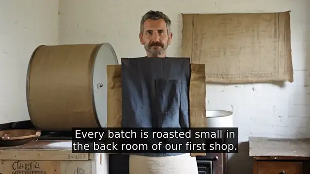
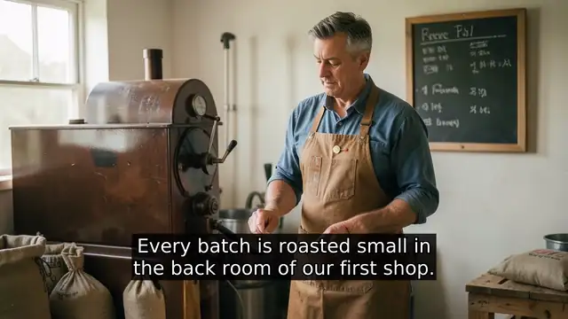
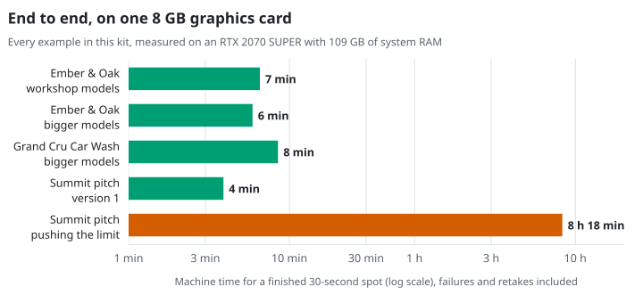
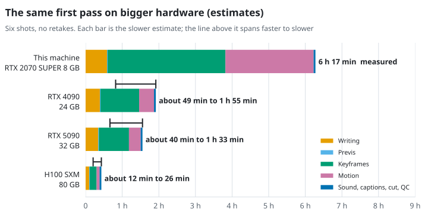

# Agentic Workflows: Zero Cost, Infinite Potential

Local-first creative AI pipelines for film and video, without the slop.

This is the starter kit for the **Tuesday Cinema Club + XPSR Creator Summit** (10/24/26): the briefs, templates, schemas, agent specs and runnable scripts for building a 30-second spot with free, local, open-source tools, with a human approving every step.

You don't need to code, and a phone is enough to take part.


## Start here

| If you are | Go to |
| --- | --- |
| Attending the summit | [The participant guide](docs/participant-guide.md) |
| Setting up a laptop | [Environment setup](environment/README.md) |
| Running the 60-minute build | [Workshop build](workshop-build/README.md) |
| Curious what the output looks like | [Watch the examples](#watch-the-examples) |
| Wondering how long it takes, or what faster hardware changes | [How long it takes](#how-long-it-takes) |
| Using a screen reader | [Accessibility notes](ACCESSIBILITY.md) |

## Summit materials

These open in Google Drive, Docs and Slides. Anyone with the link can view them; no Google account is needed to read.

| Material | What it is |
| --- | --- |
| [Presentation slides (Google Slides)](https://docs.google.com/presentation/d/1f4xDXcP211pzTOrO6uBBurJBfZXbqNYSe1a6GFWs85A/edit?usp=sharing) | The Part 1 deck: Agentic Workflows, Zero Cost, Infinite Potential. |
| [Participant worksheet (Google Docs)](https://docs.google.com/document/d/15-wb-H50hgA4E_o1oEPeZRXIZxb96HkD6AdLwkj2xBM/edit?usp=sharing) | The printable handout. A screen-reader-friendly copy is in [the participant guide](docs/participant-guide.md). |
| [Shared summit folder (Google Drive)](https://drive.google.com/drive/folders/1B5DcK_d1HLQPDtcZ6f6dGI4qb3_O1oRn?usp=sharing) | All summit files in one place. |

## Quickstart

### Phone

Nothing to install. Open this page, read the [two client briefs](workshop-build/client-briefs/), and join the Director or Auditor crew.

### Laptop (8 to 16 GB RAM)

1. Install Ollama from https://ollama.com/download, then download the writing model (about 2 GB):

   ```bash
   ollama pull llama3.2:3b
   ```

2. Copy the starter kit:

   ```bash
   git clone https://github.com/tuesday-cinema-club/xpsr-starter-kit
   cd xpsr-starter-kit
   ```

3. Test it. If the model replies, you're ready:

   ```bash
   ollama run llama3.2:3b "hi"
   ```

4. Check the rest of your setup and get a crew suggestion:

   ```bash
   python3 environment/check_setup.py
   ```

### Laptop with a GPU (8 GB or more VRAM)

Everything above, plus ComfyUI and one image model. See [the ComfyUI section of the setup guide](environment/README.md#laptop-with-gpu-8-gb-or-more-vram-about-40-gb-free).

## The ideas

1. **Snake versus charmer.** Stop rerolling and start directing. Cloud prompting works like a slot machine. A local pipeline gives you repeatable results that you control.
2. **One agent, one job.** Each agent does one job, with a limited set of tools and a defined output, such as a shot list held for approval.
3. **Script the chores, craft the film.** If a task has one right answer, like checking a file against a schema or measuring loudness, script it. If it needs taste, a human does it.
4. **Humans approve every gate.** At each gate you approve, revise, reject or ask for evidence. Approved work is saved to Git before the next stage.
5. **Two-pass motion.** Lock a still frame first, then animate only the frames you approved.
6. **The 7-point anti-slop audit.** Intent, Evidence, Continuity, Specificity, Technical QC, Provenance, and a Human signature, which is non-negotiable.

## How a project moves through the kit

1. **Brief.** The director answers three questions. A local model drafts `brief.md`. The room adds three exclusions. Gate 01.
2. **Shot list.** An agent writes `shots.json`. A script checks it against the schema, the project bible and the research log. Gate 02.
3. **Previs.** Blender blocks each shot in grey boxes with its real lens and renders a depth pass.
4. **Keyframes.** ComfyUI paints each shot inside its depth pass. Gate 03: the director approves frames before any motion.
5. **Post.** Voiceover, Whisper captions, an OpenTimelineIO timeline for Kdenlive, an animatic cut, and technical QC.
6. **Audit.** Scripts pre-fill the checks a machine can verify. People score the rest. The director signs. Gate 04.

## What is in this repository

| Folder | What it holds |
| --- | --- |
| [`docs/`](docs/README.md) | The participant guide, the Part 1 talk outline, the six-session series, and all screenshots. |
| [`environment/`](environment/README.md) | Setup by device, setup scripts for macOS, Linux and Windows, a read-only setup checker, and the hardware matrix with tested timings and model licenses. |
| [`schemas/`](schemas/README.md) | JSON Schema contracts for the brief, the project bible, the shot list and gate state, plus a validator. |
| [`agents/`](agents/README.md) | Declarative agent cards and optional OpenClaw workspace files. |
| [`pipelines/`](pipelines/README.md) | The runnable scripts for pre-production, production and post-production, and the gate tool. |
| [`workshop-build/`](workshop-build/README.md) | The 60-minute build: client briefs, schedule, crews, templates, and the anti-slop rubric. |
| [`templates/`](templates/README.md) | Project bibles for all three clients and an empty research log. |
| [`examples/`](examples/README.md) | Three complete worked runs, mistakes included, with the finished videos, and a script to rerun one yourself. |
| [`tools/`](tools/README.md) | The screenshot helper used for the docs. |

## Watch the examples

Every example below was made by this kit on one machine with an 8 GB GPU, offline, for $0. The previews loop without sound; each link opens the full 30-second cut with sound and captions.

### Ember & Oak, workshop models



[Full cut with sound (MP4)](examples/ember-and-oak-demo/cut.mp4) · [How it was made, and what broke](examples/ember-and-oak-demo/README.md)

- The brief agent credited Man with a Movie Camera to the wrong filmmaker. Caught at Gate 01.
- The shot agent passed every machine check and still dressed the roaster in "a reclaimed oak apron". Caught at Gate 02.
- The first keyframes had a missing person, a missing hand and a garbled sign. Caught at Gate 03, with every rejected take kept on record.
- Whisper heard "shop" as "shot". Caught by a person reading the captions.
- Stand-in audit: **5 of 7**. Continuity fails and the cut is not signed. That is the audit doing its job.

### Ember & Oak, bigger models



[Full cut with sound (MP4)](examples/ember-and-oak-overpowered/cut.mp4) · [The model comparison](examples/ember-and-oak-overpowered/README.md)

The same approved shot list rerun with `glm-4.7-flash` (about 30B parameters) and FLUX.2 [klein] 4B. Text drafts took up to 6 times longer, each keyframe twice as long, and the frames were usable on the first take, with the same roaster in every shot. Stand-in audit: **6 of 7**. The bigger models still invented a film reference, dropped the call to action and drew pseudo-text, so every gate still mattered.

### Grand Cru Car Wash, an ironic spot


[Full cut with sound (MP4)](examples/grand-cru-car-wash/cut.mp4) · [How it was made, and what broke](examples/grand-cru-car-wash/README.md)

A fictional car wash opens in the Temecula Valley and talks about itself like a tasting room: three "vintages", a wash sommelier, foam swirled in a glass. The joke is on the car wash, never on the valley. Stand-in audit: **5 of 7**. The sommelier grew a fedora between shots.

### Summit pitch, pushing the limit


[Full cut with sound (MP4)](examples/agentic-summit-pitch-limit/cut.mp4) · [How it was made, and what broke](examples/agentic-summit-pitch-limit/README.md)

The [summit pitch](examples/agentic-summit-pitch/README.md) rebuilt with `gpt-oss-120b` (117B parameters), FLUX.2 [dev] 32B and Wan 2.2 5B motion on the same 8 GB card, in about 8 and a half hours instead of minutes. The host holds up across four shots and the camera really moves. The biggest writing model also overflowed its context and wrote a prison-break film, which the schema check caught on the first gate. The sound was then redone in the instructor's own cloned voice (Qwen3-TTS) over a MusicGen bed; [the first cut](examples/agentic-summit-pitch-limit/before/cut.mp4) is kept for comparison. Stand-in audit: **5 of 7**. The screening room's projector moves between shots.

## How long it takes

Everything in this kit was made on one ordinary desktop with a 2019 graphics card: an RTX 2070 SUPER with 8 GB. With the workshop models a finished 30-second spot takes minutes. With the biggest models that card can run at all, it took a working day.

<picture>
  <source media="(prefers-color-scheme: dark)" srcset="docs/images/charts/e2e-examples-dark.svg">
  
</picture>

The big run is slow because its models do not fit in 8 GB and work partly from system memory. On bigger hardware the same first pass would shrink from 6 hours to under 2 hours on one RTX 4090 or 5090, and to well under half an hour on a datacenter H100:

<picture>
  <source media="(prefers-color-scheme: dark)" srcset="docs/images/charts/scaling-dark.svg">
  
</picture>

| Hardware | First pass, 6 shots with motion | |
| --- | --- | --- |
| RTX 2070 SUPER, 8 GB (this kit's machine) | 6 h 17 min | Measured |
| RTX 4090, 24 GB | about 49 min to 1 h 55 min | Estimate |
| RTX 5090, 32 GB | about 40 min to 1 h 33 min | Estimate |
| H100, 80 GB | about 12 to 26 min | Estimate |

Faster hardware buys more takes per gate and full-quality settings. It does not buy judgment: a quarter of the 8-hour run was work a gate sent back, and every one of those problems would have arrived sooner, not less often. [How long it takes](docs/performance.md) has the stage-by-stage numbers, the memory chart, and how the estimates are made.

## The $0 principle

The kit replaces an $840-a-year Adobe plan with free tools that run on your machine:

| Instead of | Use |
| --- | --- |
| Photoshop | GIMP |
| Firefly | ArtCraft or ComfyUI |
| After Effects (3D and camera) | Blender |
| Premiere Pro | Kdenlive |
| Audition | Ardour or Audacity |
| Cloud chat subscriptions | Ollama with a local model |

"Free," "open-source," "open-weight" and "local" mean different things. Check each model's license before you use it for paid work. The [hardware matrix](environment/hardware-matrix.md#model-licenses) lists the licenses for every model used here.

## Requirements

- **Required:** Python 3.9 or newer, Git, Ollama. The core scripts use only the Python standard library.
- **By crew:** Blender (Previs), ffmpeg (Edit, QC), ComfyUI and a GPU (Frames), Whisper (captions), Kdenlive and GIMP (finishing).
- **Optional Python helpers:** `pip install -r requirements.txt` (jsonschema, OpenTimelineIO, Piper text-to-speech). The setup scripts install these into `.venv`.

## Ethics

Get written consent before using any real person's face or voice. Tell your audience where you used AI. Keep provenance for every asset.

## License

Code and documentation are released under the [MIT License](LICENSE). Models you download have their own licenses; the MIT license does not cover them.
