# XPSR Director

The workshop on a phone. Four gates, the same ones the kit's scripts use, each signed by a named person before the next one opens:

1. **The brief.** The director's three answers, the key message and three exclusions.
2. **Previs.** A shot deck with lens, framing, move and timing. A phone photo or video of the blocking becomes each shot's layout reference.
3. **Production.** For every shot: a first frame, an optional last frame drawn from the first, then an action prompt that animates between them.
4. **The audit.** The seven anti-slop checks, with a human signature that the release depends on.

At the end it **renders the cut**: a `cut.mp4` from every shot's locked clip or held still, with captions and the voiceover scratch, checked by the kit's `qc_check.py`. The **Pack** button bundles it with the files the kit reads: `brief.md`, `brief.json`, `research_log.csv`, `shots.json`, `provenance.csv`, `audit.md`, `captions.srt`, `qc.json`, and the picked frames and clips. `brief.json` and `shots.json` pass `schemas/validate.py`. The pack also carries the whole project, so **Import a pack** picks up exactly where it left off.

Crews work together: each **team** gets its own link, and everyone on it edits the same project live from their own phone. A **queue** page shows every job in order, a **library** catalogues every file with what it cost, and an **admin** page sees and tidies everything.

It is a small Python server (standard library only) and a web app with no build step and no outside scripts. It runs on the machine with the GPU; phones open it over the network.

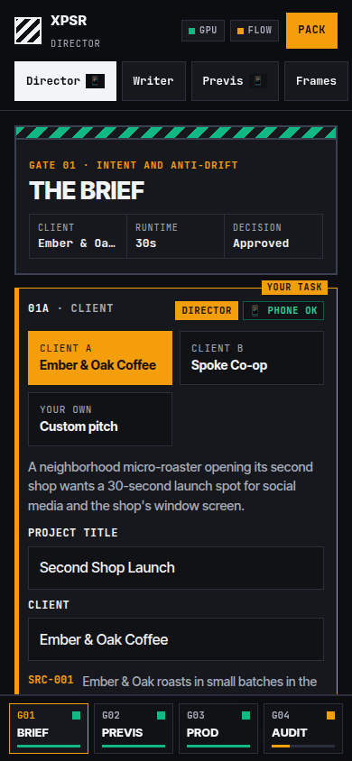

## What runs where

| Step | Engine | Where | Cost |
| --- | --- | --- | --- |
| Drafting the brief, shots, action prompts; reading shots against exclusions | Ollama (`llama3.2:3b` by default, any pulled model) | This machine's GPU | Free |
| First and last frames | FLUX.2 [klein] 4B through ComfyUI | This machine's GPU | Free, unlimited: about 30 to 40 seconds a frame on an 8 GB RTX 2070 SUPER |
| First and last frames, instead | Google Flow images (Nano Banana), **by hand** in your own Flow tab | Google | Free: no credits, no subscription |
| First and last frames, instead | Google Flow images through useapi.net (optional) | Google | 0 Flow credits; useapi.net is paid |
| First and last frames, instead | A phone photo | The phone | Free |
| First and last frames, instead | Gemini API (Nano Banana) with your own API key | Google | About $0.034 an image, inside a daily dollar cap |
| Motion, instantly | A camera move (push, pan, tilt) over the still, dissolving to the last frame | This machine's CPU (ffmpeg) | Free: 1 to 3 seconds |
| Motion, fast | LTX-Video 2B distilled through ComfyUI, from the first and last frames | This machine's GPU | Free: 59 seconds for 4 s, 87 seconds for 6.7 s |
| Motion, the examples' model | Wan 2.2 5B through ComfyUI, from the first frame | This machine's GPU | Free: about 2 minutes for a draft, about 24 minutes at full quality |
| Motion, from Google | Google Flow video (Veo 3.1, Omni 1.1 Flash), by hand or through useapi.net | Google | Flow credits, inside a daily budget |
| The cut | ffmpeg, then the kit's `qc_check.py` | This machine's CPU | Free: 6 seconds for 30 seconds |

The local model only drafts. Every suggestion lands in a box with a **Use** button, and nothing is in the brief until a person presses it.

## Start it

Python 3.10 or newer, and ffmpeg, plus Ollama and ComfyUI for the GPU steps (see [environment setup](../../environment/README.md)). For fast motion, put LTX-Video in ComfyUI (about 9.6 GB):

```bash
cd ~/ComfyUI/models
curl -L -o checkpoints/ltxv-2b-0.9.8-distilled-fp8.safetensors \
  https://huggingface.co/Lightricks/LTX-Video/resolve/main/ltxv-2b-0.9.8-distilled-fp8.safetensors
curl -L -o text_encoders/t5xxl_fp8_e4m3fn_scaled.safetensors \
  https://huggingface.co/comfyanonymous/flux_text_encoders/resolve/main/t5xxl_fp8_e4m3fn_scaled.safetensors
```

Its license is free for any use, including commercial, for companies under $10 million a year in revenue. Engines that are not installed show as "not installed" in the picker.

```bash
python3 apps/director/server.py
```

It listens on `http://127.0.0.1:8790`. On first start it makes an access code and saves it, with mode 600, in `~/.config/xpsr-director/env`. Read it with:

```bash
grep XPSR_ACCESS_CODE ~/.config/xpsr-director/env
```

To keep it running across logouts and reboots as a systemd user service:

```bash
apps/director/install-service.sh          # port 8790
systemctl --user restart xpsr-director    # after pulling changes
```

### Open it on phones

The server only listens on this machine. To reach it from phones:

| Who should reach it | Command | Address |
| --- | --- | --- |
| Your own devices on your tailnet | `tailscale serve --bg 8790` | `https://<machine>.<tailnet>.ts.net` |
| Anyone with the link (a room full of participants) | `tailscale funnel --bg 8790` | the same address, on the public internet |

With Funnel, the page itself is public, but every GPU, Flow and media request needs the access code, and wrong codes are throttled. Share the code in the room, not in the link. Turn it off afterwards with `tailscale funnel reset`.

The page installs as an app (Add to Home Screen) and opens offline: the brief, shots and audit keep working and save on the phone, and frames and motion wait for the connection.

## The gates

### Gate 01: the brief

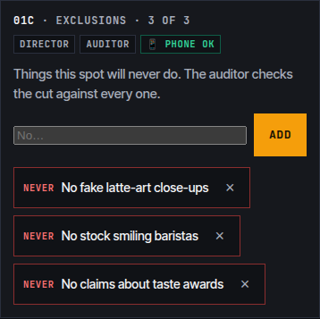

Pick Ember & Oak, Spoke Co-op or a custom pitch. The facts you may claim come from the [client briefs](../../workshop-build/client-briefs/), each with its research id. The three answers start empty on purpose: the director writes them.

Each gate closes with a slide-to-sign control and the director's name. It stays blocked until the gate's list of missing pieces is empty. Changing anything in a signed gate reopens it, because the signature covered the old version.

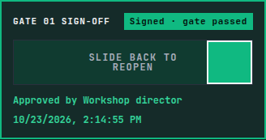

### Gate 02: previs


Shots use the kit's vocabulary (`schemas/shot_breakdown.schema.json`). A voiceover line with a claim cannot be signed off without a source id. **Record or snap** opens the phone camera. A photo is used as it is, and a video gives up one frame. Either becomes the layout reference for that shot's first frame.

### Gate 03: first frame, last frame, action


This is the kit's two-pass rule made visible:

1. **First frame.** Render takes, tap one to pick it, lock it. The source can be the local GPU, the Gemini API, Flow by hand, Flow through useapi.net or a phone photo, set per shot or for the whole project.
2. **Last frame, optional.** Say only what has changed. It is drawn with the locked first frame as its reference, so the room, the people and the light carry over. Skip it and the video model decides where the shot ends.
3. **Action.** Pick a motion engine, describe only what moves between the two frames (the local model can draft it), and render. Or **hold the still** and spend nothing.


| Engine | Uses | Time on an RTX 2070 SUPER | Notes |
| --- | --- | --- | --- |
| Camera move | First frame, and the last frame if there is one | 1 to 3 seconds | ffmpeg moves the camera the way the shot says (push in, pull out, pan, tilt, handheld) and dissolves into the last frame through the middle third. Nothing in the frame changes shape, so it never invents anything. |
| LTX-Video | First and last frames | About a minute | 832 by 480, up to 161 frames (6.7 seconds). The default when it is installed. |
| Wan 2.2 draft | First frame | About 2 minutes | 640 by 352, up to 3 seconds: a quick look. |
| Wan 2.2 full | First frame | About 24 minutes | 1280 by 704, up to 5 seconds: the quality of the kit's examples. |
| Flow by hand | First and last frames | 1 to 3 minutes on Google | Collapsed steps: copy the action, save the frames, make it in your own Flow tab, bring the clip back. |
| Flow via useapi | First and last frames | 1 to 3 minutes on Google | Paid bridge; see below. |

A clip shorter than its shot holds its last frame in the cut; a longer one is trimmed. The local engines join the GPU queue, one at a time.

Motion stays locked until the frames are locked, in the app and again on the server. Unlocking a first frame unlocks the last frame and motion built on it, and reopens picture lock.


### Gate 04: the audit

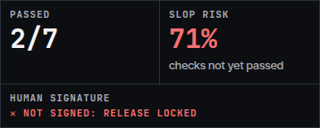

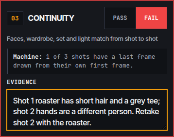

Each check gets Pass or Fail and one line of evidence. A machine note shows what the app can count: cited lines, logged assets, last frames drawn from first frames. Check 1 can ask the local model to read every shot against the exclusions, but the auditor decides. **Slop risk** is simply the share of checks not yet passed. Check 7 cannot pass until a director's signature is typed, and the pack is marked for release only at 7 of 7.

### Render the cut

The first card in Gate 04 renders the whole spot on this machine:

1. **Assemble.** Each shot's locked motion take is trimmed to the shot's length, or held on its last frame if it is short. A shot without motion holds its first frame.
2. **Caption and mix.** The voiceover lines are burned in as captions (optional), and the voiceover scratch from Gate 03 goes underneath, normalised to -14 LUFS.
3. **Check.** The kit's `qc_check.py` measures the result against the client's bible: resolution, frame rate, runtime, loudness and peaks. Check 5 of the audit shows the result.

In testing, a 30-second, three-shot cut took 6 seconds and passed every check (1920 by 1080, 24 fps, 30.00 seconds, -15.1 LUFS, -1.5 dBTP). Every render is kept as a version. The newest goes into the pack as `cut.mp4`, with `captions.srt` and `qc.json`.

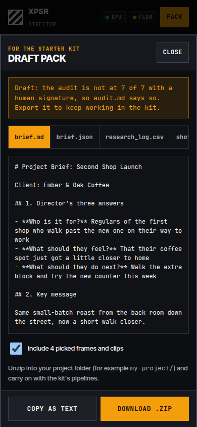

## Pick up from a pack

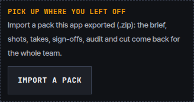

Every pack carries `xpsr-director.json`: the whole project, with sign-offs, takes, the audit and the cut versions. **Import a pack** in Gate 01 brings it back on a personal project or a team, and works on a different server too:

- **Media the server still has** is used as it is.
- **Frames, clips, the cut and the voiceover in the ZIP** are uploaded again.
- **Takes that are in neither** are dropped.

A pack without that file, such as an older one or one edited by hand, is rebuilt from `brief.json`, `shots.json`, `research_log.csv`, `provenance.csv` and the frame files, with the gates left for the director to sign again.

## Teams, the queue and the admin

### Teams: one link per crew

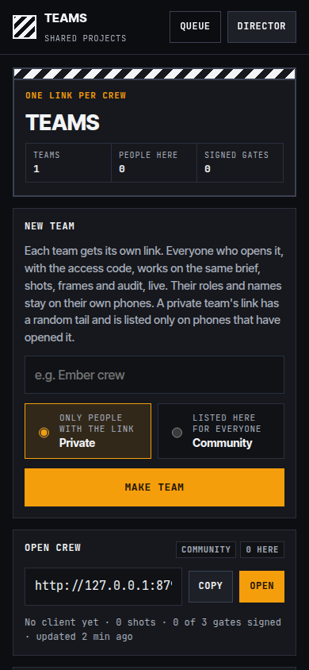

`/teams` makes a team and gives it a link, such as `https://<machine>.<tailnet>.ts.net/t/ember-crew`.

- **Shared live:** everyone who opens the link, with the access code, works on the same project from their own phone. Changes arrive within a few seconds.
- **Typing is safe:** the field you are typing in, and any half-typed exclusion, is never overwritten by a teammate's change.
- **Stays on each phone:** your role and your name.
- **Shared with the team:** the brief, shots, takes, audit, cuts and the voiceover.
- **Same queue:** a frame or clip one person starts shows up for everyone.

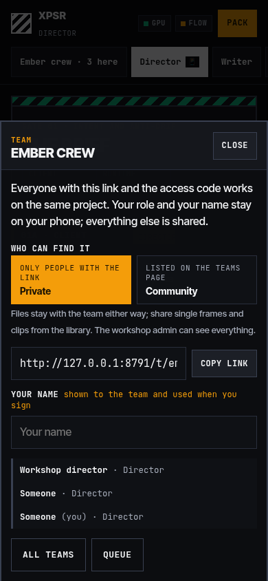

| Visibility | Who can find it | Link |
| --- | --- | --- |
| Private (the default) | Only people with the link. It is listed only on phones that have opened it. | Has a random tail, such as `/t/ember-crew-7f3a9c21`, so the name alone does not find it |
| Community | Everyone in the workshop, on the teams page | Plain, such as `/t/open-crew` |

Files belong to the team that made them, so the library shows a team only its own frames and clips. Anyone on a team can **share** a single frame or clip with the community from the library, and everyone then sees it under **Community** and can use it in their own shots.

This is privacy by organisation, not by security. Everyone in the room has the same access code, so anyone who learns a private team's link can open it. Use separate servers for work that must stay apart.

### The queue

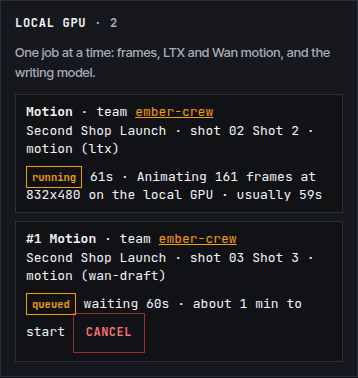

`/queue` shows every job from every team, in order, refreshed every 2 seconds:

- **Local GPU lane:** frames, LTX and Wan motion, and the writing model, one at a time and first come, first served.
- **Render lane:** camera moves and cuts.
- **Google Flow lane:** runs in parallel.

Each job shows its place in line, how long it has run, and a typical time from recent runs. A job still waiting can be cancelled.

### Admin

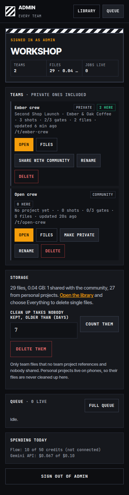

`/admin` takes its own code, `XPSR_ADMIN_CODE`, which is separate from the room's access code. It is made on first start, and you read it with:

```bash
grep XPSR_ADMIN_CODE ~/.config/xpsr-director/env
```

What the admin can do:

- **Teams:** see every team, private ones included, then open, rename, make private or share, and delete.
- **Deleting a team:** optionally takes every file the team made with it.
- **Library:** with **Everything** selected, see every file with its team, and delete any single file.
- **Clean up:** count, then delete, team takes that no project uses and nobody shared, older than a number of days.
- **Status:** the live queue, and today's Flow and Gemini spending.

The admin session lasts a day. Change the code in the env file to sign every admin out.

## Gemini API (your own key)

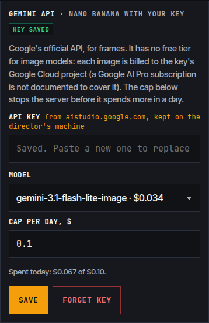

Google's official API can make the frames too. Tap **FLOW** in the header, paste a key from [Google AI Studio](https://aistudio.google.com) into **Gemini API**, and choose **Gemini API** as a frame source.

**It is not free.** Google's pricing page lists no free tier for any image model in October 2026. The cheapest, `gemini-3.1-flash-lite-image`, is about $0.034 per 1K image, billed to the key's Google Cloud project, and a Google AI Pro subscription is not documented to cover API use. So the server keeps a dollar ledger per day and refuses any image over the cap (`GEMINI_DAILY_USD`, $1.00 by default, about 30 images). The key is stored like the others: in the env file, never in the browser or the repo.

The request uses the Interactions API (`POST /v1beta/interactions` with `response_format` set to an image), and falls back to `generateContent` if a model is not served there. For a last frame, the locked first frame goes along as the reference.

**Why not embed Flow itself?** labs.google refuses to be shown inside another site, and Google sign-in does not work inside an embedded frame, so the app links to Flow in a new tab instead.

## Google Flow, by hand (free)

Flow's Nano Banana images cost no credits, and a free Google account gets about 50 Flow credits a day for clips. You can use both without any bridge or subscription: the app prepares the work, you press generate in your own Flow tab, and the file comes back to be catalogued.

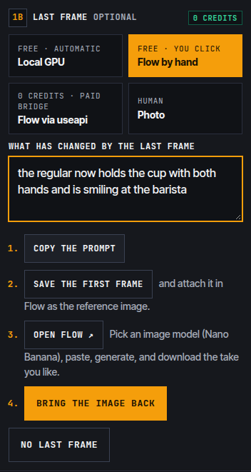

**Frames.** Choose **Flow by hand** as the source, for one shot or the whole project.

1. **Copy the prompt.** For a last frame the app writes the full instruction: keep the place, people and light of the attached first frame, change only what you described.
2. **Save the reference.** For a last frame that is the locked first frame; for a first frame, the phone blocking photo if there is one. Attach it in Flow.
3. **Open Flow.** Pick Nano Banana, paste, generate, and download the take you like.
4. **Bring the image back.** It joins the shot's takes and is catalogued in the library as a Flow frame made by hand. Its provenance row records the model and the exact prompt.

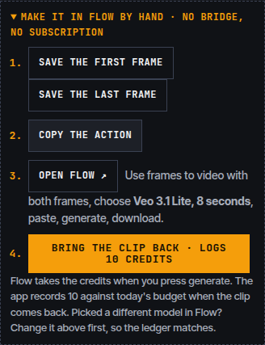

**Clips.** Under the action prompt, open **Make it in Flow by hand**. Choose the model above first, because that sets the credit cost the ledger records.

1. **Save the frames.** Save the first frame, and the last frame if there is one.
2. **Copy the action.**
3. **Open Flow.** In frames to video, use the same model and length, paste, generate, and download.
4. **Bring the clip back.** Pick the MP4 Flow downloaded. The app catalogues it and records its credits against today's budget, so the library's **Where the credits went** still shows which clip each credit bought.

Flow is the one that charges, when you press generate, so the app can only warn you, not stop you. The budget bar shows what is left before you go to Flow.

## Google Flow through useapi.net (optional, paid)

To render from inside the app instead, without leaving it, connect [useapi.net](https://useapi.net/docs/api-google-flow-v1). It is a paid third-party service that runs Flow on your own Google account and solves the captcha Flow puts on every generation. The app is a client of useapi.net's documented REST API. It does not talk to Google's private endpoints itself and it does not solve captchas.

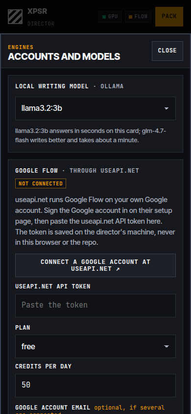

### Connect it

1. Make a useapi.net account and subscribe. Their service is paid; the Flow credits are what's free.
2. Connect your Google account on their [Google Flow setup page](https://useapi.net/docs/start-here/setup-google-flow). You sign in on their automated browser; you do not paste cookies anywhere.
3. In the app, tap **FLOW** in the header, paste the useapi.net API token, set your plan and a daily credit budget, and save.
4. Tap **Check connected accounts** to see each Google account's health and live credit balance.

The token is written to `~/.config/xpsr-director/env` on the machine (mode 600). It is never sent to the browser and never stored in the repo. **Forget token** removes it.

### Credit costs and the budget guard

From useapi.net's price table (October 2026; their figures are averages from busy accounts, not guarantees):

| Model | Clip | Credits, free to Pro plans | Plans |
| --- | --- | --- | --- |
| Veo 3.1 Lite | 8 s | 10 | All, including free |
| Veo 3.1 Fast | 8 s | 20 | All, including free |
| Veo 3.1 Quality | 8 s | 100 | All (more than a free day) |
| Omni 1.1 Flash 720p | 4, 6, 8, 10 s | 7, 10, 12, 15 | Plus and up |
| Omni 1.1 Flash 360p | 4, 6, 8, 10 s | 4, 5, 6, 7 | Plus and up |
| Nano Banana images | | 0 | All |

- **Free accounts get about 50 credits a day:** 5 Veo Lite clips or 2 Veo Fast clips. Omni needs a paid plan. On Plus (200 credits a month), 4-second Omni 360p tests cost 4 credits each.
- **Every image and clip needs one captcha solve.** useapi.net gives the first account 300 free solves, then asks for your own solving service at about $0.80 to $3.00 per 1,000. Frames made on the local GPU use none.
- **The server keeps a credit ledger per local day.** Through useapi.net it refuses any clip that would go over the daily budget, or over the live balance the account last reported, and a failed job puts its credits back. Clips made by hand are recorded when they come back.
- **The budget and plan live in the env file:** `FLOW_PLAN=free|plus|pro|ultra` and `FLOW_DAILY_CREDITS=50`. Change them from the accounts sheet.

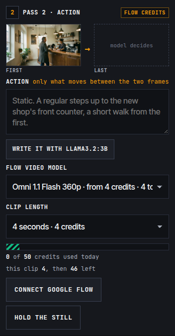

### The risk

Automating Flow through a third party may go against Google's terms. Google can limit or suspend an account that does it. Use an account you can afford to lose, and read [useapi.net's legal page](https://useapi.net/docs/legal) first.

## Library: every file, and the credits it cost

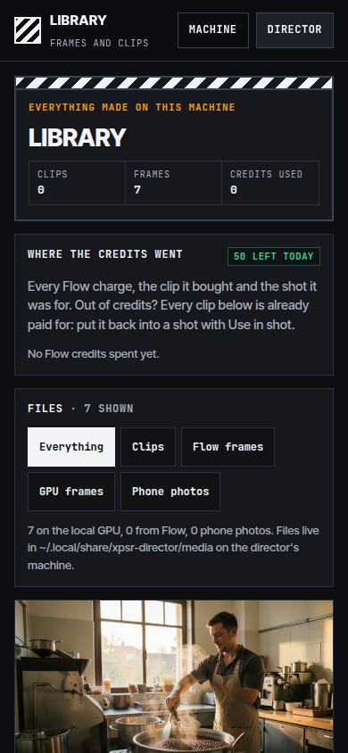

`/library` lists every frame and clip the server has made or received. Each one shows its model, seed, prompt, date and size, and a download link. Clips also show their credit cost, and frames link to the reference they were drawn from. **Where the credits went** groups every Flow charge by day, next to the clip it paid for and the shot it was for. Failed jobs are struck through and shown as refunded.

Out of credits? Every clip there is already paid for. **Use in shot** puts it back as a take in any shot of the current project. Its provenance row says it was reused and that its credits were spent earlier.

Files live in `~/.local/share/xpsr-director/media`, and the job log and ledger in `~/.local/share/xpsr-director/store.json`.

## Machine resources


`/resources` shows the machine live, refreshed every 1.5 seconds while it is open:

- **GPU:** busy share, graphics memory split between Ollama and ComfyUI, temperature, power, clocks and PCIe link.
- **CPU:** load, with a heat grid of every thread.
- **Memory:** system memory and swap.
- **Engines and disks:** which Ollama models are loaded, ComfyUI's queue, today's Flow credits, disk use, and the recent jobs with how long each took.

Every graph also has its numbers as text.

The server keeps the GPU to one job at a time. Before a frame it unloads Ollama's models, and before the writing model runs it asks ComfyUI to free its memory, so the two never fight over the 8 GB card. The resources page shows the handoff.

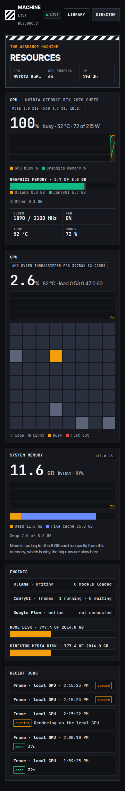

## Settings

All optional, in `~/.config/xpsr-director/env` or the environment:

| Key | Default | What it does |
| --- | --- | --- |
| `XPSR_ACCESS_CODE` | made on first start | The code phones enter. Change it and restart to sign everyone out. |
| `USEAPI_TOKEN` | none | useapi.net token. Set from the app. |
| `FLOW_PLAN` | `free` | `free`, `plus`, `pro` or `ultra`: which models and clip lengths are offered. |
| `FLOW_DAILY_CREDITS` | `50` | Hard cap per local day. |
| `FLOW_EMAIL` | none | Which connected Google account to use, if there are several. |
| `OLLAMA_URL`, `OLLAMA_MODEL` | `http://127.0.0.1:11434`, `llama3.2:3b` | Writing model. |
| `COMFYUI_URL` | `http://127.0.0.1:8188` | Frame renderer. Frames use `pipelines/02-production/workflows/flux2_klein_*.json`. |
| `XPSR_ADMIN_CODE` | made on first start | The admin page's code. |
| `GEMINI_API_KEY`, `GEMINI_IMAGE_MODEL`, `GEMINI_DAILY_USD` | none, `gemini-3.1-flash-lite-image`, `1.00` | Gemini API frames. Set from the app. |
| `XPSR_ENV`, `XPSR_DATA` | `~/.config/xpsr-director/env`, `~/.local/share/xpsr-director` | Where secrets and media live. |

## Security notes

- **Secrets stay out of the repo.** The env file lives in your home folder, not the repo, and is written with mode 600.
- **The admin has a separate code and session.** Only it lists private teams or deletes anything.
- **Every API request needs the code.** It arrives as an HttpOnly, SameSite=Strict session cookie (Secure behind Tailscale). Every POST also needs a custom header, so other sites cannot send requests on a visitor's behalf.
- **Wrong codes are throttled.** Eight wrong codes from one address lock it out for ten minutes.
- **The page loads nothing from other sites.** It sends a strict Content Security Policy. Media names are random, and the static file server refuses paths outside `web/`.

## Files

| File | What it is |
| --- | --- |
| `server.py` | The server: static files, the access code, jobs, the Ollama, ComfyUI and useapi.net clients, the credit ledger, the library and resources APIs. |
| `install-service.sh` | Installs the systemd user service. |
| `web/index.html`, `app.js`, `app.css` | The four-gate app. |
| `web/data.js` | Roles, the two clients' facts, shot vocabulary, the seven checks. |
| `web/pack.js`, `web/zip.js` | Builds the kit's files and the ZIP, with no library. |
| `web/api.js` | Server calls, and photo and video-frame conversion before upload. |
| `web/resources.*`, `web/library.*` | The resources and library pages. |
| `web/queue.*`, `web/teams.*`, `web/admin.*`, `web/page-common.js` | The queue, teams and admin pages. |
| `web/unzip.js` | Reads a pack back in for Import a pack. |
| `../../pipelines/02-production/workflows/ltxv_2b_first_last_to_motion.json` | The LTX-Video first-and-last-frame workflow. |
| `web/sw.js`, `manifest.webmanifest`, `icon*` | Offline shell and home-screen install. |
| `web/fonts/` | JetBrains Mono and Inter Tight, bundled (SIL Open Font License). |
