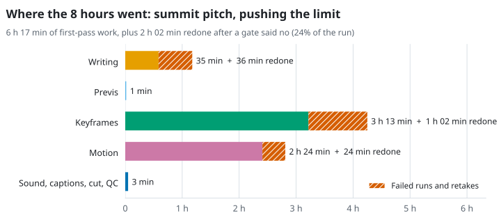
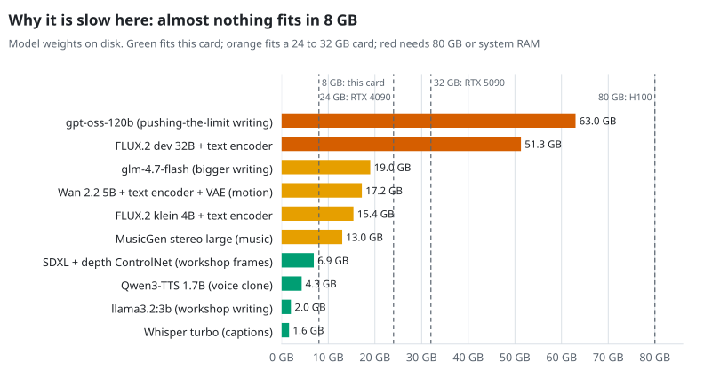

# How Long It Takes

Every example in this kit was made on one ordinary desktop. This page has the measured times, explains why the biggest models were so slow there, and estimates what faster hardware would change.

The charts are drawn by [`tools/make_charts.py`](../tools/make_charts.py), which holds every number on this page. Rerun it after changing the data.

## The machine

| Part | Detail |
| --- | --- |
| GPU | NVIDIA GeForce RTX 2070 SUPER, 8 GB, on PCIe 3.0 x16. A 2019 mid-range card with no FP8 support. |
| CPU | AMD Ryzen Threadripper PRO 3975WX, 32 cores and 64 threads |
| System memory | 109 GB (eight-channel DDR4) |

The large amount of system memory is what made the "pushing the limit" run possible at all: the models that do not fit on the card run partly from system RAM.

## Measured: end to end

<picture>
  <source media="(prefers-color-scheme: dark)" srcset="images/charts/e2e-examples-dark.svg">
  
</picture>

| Example | Writing | Images | Motion | Machine time, retakes included |
| --- | --- | --- | --- | --- |
| [Ember & Oak, workshop models](../examples/ember-and-oak-demo/README.md) | `llama3.2:3b` | SDXL | None | about 7 minutes |
| [Ember & Oak, bigger models](../examples/ember-and-oak-overpowered/README.md) | `glm-4.7-flash` | FLUX.2 [klein] 4B | None | about 6 minutes |
| [Grand Cru Car Wash](../examples/grand-cru-car-wash/README.md) | `glm-4.7-flash` | FLUX.2 [klein] 4B | None | about 8 minutes |
| [Summit pitch, version 1](../examples/agentic-summit-pitch/README.md) | `llama3.2:3b` | FLUX.2 [klein] 4B | None | about 4 minutes* |
| [Summit pitch, pushing the limit](../examples/agentic-summit-pitch-limit/README.md) | `gpt-oss-120b` | FLUX.2 [dev] 32B | Wan 2.2 5B | 8 hours 18 minutes |

\* Keyframe times are measured (`frames.json`); for this example the text, previs and post steps use the workshop stack's measured times.

The bigger models on the Ember & Oak job were slower per frame and still finished sooner, because their first takes were usable. The pushing-the-limit run took 60 to 120 times as long as the others. Part of that is the work itself: twice the shots, frames at 1920 by 1056, and real motion. Most of it is hardware, as the next two charts show.

## Measured: where the 8 hours went

<picture>
  <source media="(prefers-color-scheme: dark)" srcset="images/charts/limit-breakdown-dark.svg">
  
</picture>

| Stage | First pass | Redone | Why it was redone |
| --- | --- | --- | --- |
| Writing (`gpt-oss-120b`) | 35 min | 36 min | The model's thinking overflowed its context and it wrote a prison-break film |
| Previs (Blender) | about 1 min | | |
| Keyframes (FLUX.2 [dev], 28 to 34 min each) | 3 h 13 min | 1 h 02 min | Shot 4 in the wrong room; pseudo-text on shot 6's slate |
| Motion (Wan 2.2 5B, 24 min each) | 2 h 24 min | 24 min | Shot 6 pushed in instead of pulling out |
| Sound, captions, cut, QC | about 3 min | | |

A quarter of the run was work a gate sent back. On slow hardware, a gate that catches a problem early saves hours. Bigger hardware shrinks the hours; it does not remove the need for the gates.

## Why it is slow here

<picture>
  <source media="(prefers-color-scheme: dark)" srcset="images/charts/model-memory-dark.svg">
  
</picture>

The workshop models fit the 8 GB card. Everything in the pushing-the-limit run does not, so it runs partly or mostly from system memory. Two different limits follow from that:

- **Image and motion models are limited by compute.** One FLUX.2 [dev] step at this size pushes about 16,600 tokens (the 1920 by 1056 frame, two 1-megapixel reference images and the prompt) through 32 billion parameters: well over a petaFLOP once attention is counted. At the 2070 SUPER's 36 TFLOPS that is 30 to 40 seconds per step at perfect efficiency, and the measured 72 seconds is about half the card's peak. Streaming the weights that do not fit over PCIe adds only a few seconds per step.
- **The writing model is limited by memory bandwidth.** Each new word of `gpt-oss-120b` reads a few gigabytes of weights. From system RAM that is far slower than from graphics memory, so it speeds up a lot only when all 63 GB fit on the card.

## Estimated: the same work on bigger hardware

<picture>
  <source media="(prefers-color-scheme: dark)" srcset="images/charts/scaling-dark.svg">
  
</picture>

| Hardware | Writing | Keyframes, 6 | Motion, 6 | First pass in all |
| --- | --- | --- | --- | --- |
| This machine, RTX 2070 SUPER 8 GB (measured) | 35 min | 3 h 13 min | 2 h 24 min | **6 h 17 min** |
| RTX 4090, 24 GB | 14 to 23 min | 23 to 63 min | 9 to 24 min | **about 49 min to 1 h 55 min** |
| RTX 5090, 32 GB | 12 to 21 min | 17 to 49 min | 7 to 19 min | **about 40 min to 1 h 33 min** |
| H100 SXM, 80 GB | 3 to 6 min | 4 to 11 min | 2 to 5 min | **about 12 to 26 min** |

**These are estimates, not measurements.** How they are made:

- **Keyframes and motion** scale with each card's dense tensor throughput from the vendor spec sheets: FP16 with FP32 accumulate for the slower estimate, FP8 for the faster one where the card supports it. The slower estimate also assumes the bigger card reaches only 70 percent of the 2070 SUPER's utilization. Where the weights do not fit, the time to stream the overflow across PCIe is added to every step. FLUX.2 [dev]'s 34 GB transformer overflows the 24 and 32 GB cards; Wan 2.2 5B fits all three.
- **Check against a published number:** the Wan 2.2 project reports a 5-second 720p TI2V-5B clip in under 9 minutes on one RTX 4090 at its default 50 steps. That is about 3.6 minutes at the 20 steps used here, and the slower estimate above is 4 minutes per clip.
- **Writing** is limited by memory bandwidth. With 24 or 32 GB, most of `gpt-oss-120b` still lives in system RAM, so the estimate is 1.5 to 3 times faster. With 80 GB it all fits in fast graphics memory: 6 to 12 times faster.
- **Previs, sound, captions and the cut** already take a few minutes and barely change.

### What the faster hardware buys, beyond speed

- **More takes per gate.** On this machine one FLUX.2 [dev] frame costs half an hour, so the director sees one take per shot. At a few minutes a frame, a seed sweep of four takes per shot fits in the time one take took here, and picking the best of four is the cheapest quality gain in the kit.
- **Full-quality settings.** The motion clips here used 20 steps to save time; Wan 2.2's default is 50. Larger motion models (Wan 2.2 14B) and longer clips become practical with 24 GB or more.
- **The writing model inside the workshop hour.** A 30-minute shot list does not fit a 60-minute build; a 5-minute one does.

What it does not buy: the prison-break film, the wrong room and the pseudo-text all came from the models, not the hardware. Every one of them would have been made faster, and every one of them still needed a person at the gate to catch it.
