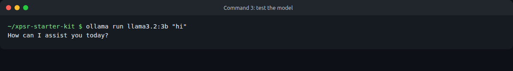
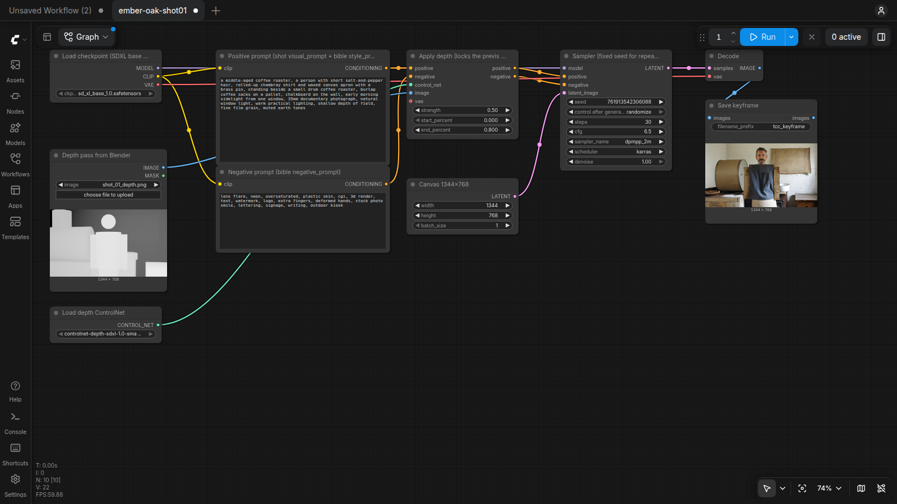
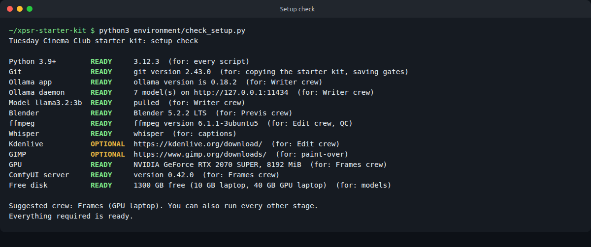

# Environment Setup

How to install the local studio. Only do the part for your device. A phone needs nothing installed.

For hardware tiers, tested versions, timings and model licenses, see [the hardware matrix](hardware-matrix.md).

## Phone

Nothing to install.

1. Free up 2 GB of space.
2. Test the camera and voice memos.
3. Bookmark the starter kit: github.com/tuesday-cinema-club/xpsr-starter-kit
4. Bring a charger.

## Laptop (8 to 16 GB RAM, about 10 GB free)

### Option A: the setup script

From the repository folder:

- **macOS or Linux:** `bash environment/setup-mac-linux.sh`
- **Windows (PowerShell):** `powershell -ExecutionPolicy Bypass -File environment\setup-windows.ps1`

The script installs Ollama if it is missing (it asks first on Linux; on Mac and Windows it points you to the installer), pulls `llama3.2:3b`, creates a Python virtual environment in `.venv` with the optional helpers, and runs the setup check. It does not install anything else.

### Option B: by hand

Open Terminal (Mac or Linux) or PowerShell (Windows), paste one line, then press Enter.

1. Install Ollama from https://ollama.com/download, then download the writing model (about 2 GB):

   ```bash
   ollama pull llama3.2:3b
   ```

2. Copy the starter kit:

   ```bash
   git clone https://github.com/tuesday-cinema-club/xpsr-starter-kit
   cd xpsr-starter-kit
   ```

3. Test it. If the model replies, you are ready:

   ```bash
   ollama run llama3.2:3b "hi"
   ```

   

4. Install the creative tools you will use:
   - Blender for 3D blocking: https://www.blender.org/download/
   - Kdenlive for editing: https://kdenlive.org/download/
   - GIMP for paint-over: https://www.gimp.org/downloads/
   - ffmpeg for the animatic and QC scripts: https://ffmpeg.org/download.html
   - Optional: Whisper for captions (`pip install openai-whisper`, or whisper.cpp for faster CPU transcription) and ArtCraft.

## Laptop with GPU (8 GB or more VRAM, about 40 GB free)

Everything in the laptop section, plus ComfyUI and one image model.

### ComfyUI

```bash
git clone https://github.com/comfyanonymous/ComfyUI.git
cd ComfyUI
python3 -m venv .venv
# NVIDIA: install PyTorch for your CUDA version first, see https://pytorch.org/get-started/locally/
.venv/bin/pip install torch torchvision torchaudio --index-url https://download.pytorch.org/whl/cu128
.venv/bin/pip install -r requirements.txt
.venv/bin/python main.py --listen 127.0.0.1 --port 8188
```

On Windows, the ComfyUI portable download from the ComfyUI releases page is simpler. On Apple Silicon, skip the `--index-url` part; the default PyTorch build uses the GPU through Metal.

### Models used by the depth workflow

Put each file in the ComfyUI folder shown:

| File | Folder | Size | Source |
| --- | --- | --- | --- |
| `sd_xl_base_1.0.safetensors` | `models/checkpoints/` | 6.9 GB | huggingface.co/stabilityai/stable-diffusion-xl-base-1.0 |
| `controlnet-depth-sdxl-1.0-small.safetensors` (rename from `diffusion_pytorch_model.fp16.safetensors`) | `models/controlnet/` | 320 MB | huggingface.co/diffusers/controlnet-depth-sdxl-1.0-small |

For the stronger FLUX.2 [klein] 4B workflow (`workflows/flux2_klein_previs_reference.json`), add these from huggingface.co/Comfy-Org/Flux-2-Klein-4B (about 16 GB in total):

| File | Folder | Size |
| --- | --- | --- |
| `flux-2-klein-4b.safetensors` | `models/diffusion_models/` | 7.8 GB |
| `qwen_3_4b.safetensors` (text encoder) | `models/text_encoders/` | 8.0 GB |
| `flux2-vae.safetensors` | `models/vae/` | 340 MB |

It runs on an 8 GB card by keeping part of the model in system RAM, so 32 GB or more of RAM helps. Optional motion: Wan 2.2 5B.

Render one test frame in the ComfyUI page at http://127.0.0.1:8188 before the workshop.



## Check everything

```bash
python3 environment/check_setup.py
```

It reports READY, MISSING or OPTIONAL for each part and suggests a crew. It installs nothing.



## Files in this folder

| File | What it does |
| --- | --- |
| `check_setup.py` | Read-only readiness check with a crew suggestion. |
| `setup-mac-linux.sh` | Setup script for macOS and Linux. |
| `setup-windows.ps1` | Setup script for Windows PowerShell. |
| `hardware-matrix.md` | Hardware tiers, tested versions, timings and model licenses. |

## Free up disk space

List your models, then remove the ones you do not need:

```bash
ollama list
ollama rm <model-name>
```

Keep one image model, not several. Large models can live on an external drive.
