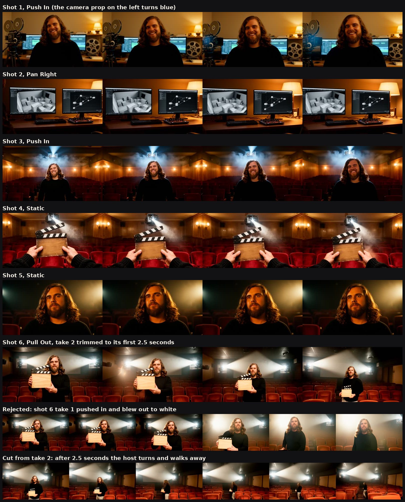

# Worked Example: Summit Pitch, Pushing the Limit

The [summit pitch](../agentic-summit-pitch/README.md) rebuilt with the biggest models one 8 GB graphics card can run at all. It was made on one machine on 2026-10-22 and 23, offline, for $0, in about 8 and a half hours of machine time. The first version took minutes.

![Animated preview, no sound: the instructor smiling at the edit desk with a vintage film camera and reels; two monitors showing grey-box previs and a node graph; the instructor in the aisle of a wood-panelled screening room under a projector beam; two hands holding a bare wooden clapperboard in front of red velvet seats; a close-up of the instructor lit from the side; the instructor raising the clapperboard as the camera pulls back, under the typed end card "Agentic Workflows, Tuesday Cinema Club + XPSR Creator Summit, 10/24/26, github.com/tuesday-cinema-club/xpsr-starter-kit".](cut-preview.webp)

[Watch the full 30-second cut with sound (MP4)](cut.mp4). There is also [a version with a selectable caption track](cut_softsubs.mp4). The preview above loops without sound.

The sound was redone after the first cut, at the instructor's request: the lines are now read in the instructor's own cloned voice over a generated music bed. The first cut is kept for comparison: [before (MP4)](before/cut.mp4), [after (MP4)](cut.mp4). See [Sound pass: before and after](#sound-pass-before-and-after).

## The two versions side by side

| | [Version 1](../agentic-summit-pitch/README.md) | Pushing the limit (this folder) |
| --- | --- | --- |
| Writing | `llama3.2:3b` (3B parameters) | `gpt-oss-120b` (117B parameters, 63 GB), thinking on high |
| Keyframes | FLUX.2 [klein] 4B, 37 seconds per frame | FLUX.2 [dev] 32B, 28 to 34 minutes per frame, at 1920 by 1056 |
| Motion | None: stills with a digital move | Wan 2.2 5B: a real 5-second clip per shot, 24 minutes each |
| Voice | Piper `en_US-bryce-medium` | Kokoro-82M `am_michael` in the first cut; now the instructor's own voice, cloned with Qwen3-TTS 1.7B |
| Music | None | MusicGen stereo large (3.3B), ducked under the voice |
| Captions | Whisper `base.en` | Whisper `turbo` (large-v3-turbo) |
| Shots | 3 (9, 9 and 12 seconds) | 6 (5 seconds each, the motion model's limit) |
| Machine time | Minutes | About 8 and a half hours, failures included |

Both versions use the instructor's own reference photo ([`refs/instructor_reference.jpg`](refs/instructor_reference.jpg)), with `consent_on_file: true` in [the project bible](../../templates/agentic-summit-pitch-bible.json).


**What the extra compute bought:** a recognizable host in four different shots, real camera moves instead of a digital zoom on a still, a more natural voice, and captions with no misheard words.

**What it did not buy:** every gate still caught something. The biggest writing model wrote a prison-break film on its first run. The shot list still needed a rewrite. Two of six keyframes and one of six motion clips were retaken, and the final continuity check still fails.

## About the gate decisions in this example

There was no human director in the room. Gate decisions are recorded as "Workshop director (demo stand-in)", and the Revise notes, rewrites and retakes were made by Claude, the AI assistant that built and ran the kit. **The release is not signed.** The voice is synthetic and marked SCRATCH.

## What happened at each gate

### Gate 01: Brief

- **Agent:** `gpt-oss-120b` with `--think high` drafted a valid brief in 4 minutes 35 seconds ([`brief.agent-draft.json`](brief.agent-draft.json)). All three film references were real works.
- **What broke:** the key message was a feature list rather than a sentence a person would say, and it wrote "$840-year". It chose the pastel palette of The Grand Budapest Hotel, which contradicts the bible's obsidian and amber look. And the client name left out the summit.
- **Human fix:** Revise. The key message became "Direct your own film on your own machine: one agent per job, a human at every gate, and no subscription." The references became Agnès Varda's The Beaches of Agnès, Gordon Willis's photography of The Godfather and Brian Eno's Music for Airports. Approve.

### Gate 02: Shot list, first run: not our film

- **Agent:** 35 minutes 27 seconds, 3 attempts, and every attempt failed the schema check.
- **What broke:** the draft is a five-scene prison break called "The Great Escape", with a prisoner, a hidden key and a moonlit courtyard ([`shots.agent-draft-context-overflow.json`](shots.agent-draft-context-overflow.json)). The model's thinking had overflowed Ollama's default context of about 4,000 tokens, which pushed the brief, the bible and the instructions out of its memory. It then wrote whatever it liked.
- **Human fix:** Reject ([`shots_state.context-overflow.json`](shots_state.context-overflow.json)). `common.py` now asks for a 16,000-token context whenever thinking is on.

This is the strongest argument in the kit for checkers and gates. A bigger model failed in a way that looked confident and was completely off-brief, and the schema check and the director caught it in seconds.

### Gate 02: Shot list, second run

- **Agent:** 30 minutes 28 seconds, 2 attempts ([`shots.agent-draft.json`](shots.agent-draft.json)). The checker sent attempt 1 back because shot 6 made a claim with no source.
- **What broke:**
  - The lines read like notes ("One agent per job, human approves each gate before next stage.").
  - The host was on screen in 2 of 6 shots, though the brief has the host talking to camera.
  - Shot 3 needed six labelled software logos and shot 6 a phone with a button and a QR code. Both are generated text, which image models garble.
  - Shot 3 said Wide while its prompt said close-up.
  - There was no call to action, and the spot ran 27 seconds.
- **Human fix:** Revise, then a hand rewrite: six 5-second shots with the host in four of them and no generated text. Real text goes on the typed end card. `--check-only` passed. Approve.
- **Previs:** two new grey-box sets were added to `blender_previs.py`, `edit_studio` and `screening_room`, and previs now renders at 1920 by 1056 (`--size`). The first previs showed shot 2 as a Close Up filling the frame with one blank monitor, so the director reframed it as a Medium.
- **Voiceover timing:** the first Kokoro read ran shot 6 to 5.3 seconds, past the end of the spot. The line was shortened to "October 24th: join the Tuesday Cinema Club." and the voice sped up 10 percent (`--speed 1.1`). Approved again.

### Gate 03: Keyframes

FLUX.2 [dev] got two references per shot: the Blender depth pass for composition, and the instructor's photo for the face ([`flux2_dev_character_previs.json`](../../pipelines/02-production/workflows/flux2_dev_character_previs.json)). Shots without the instructor drop the photo.

- **Take 1:** shots 1, 2, 3 and 5 were usable first time. Shot 2's monitors show grey boxes and a node graph that echo the previs itself, with no readable text.
- **What broke:** shot 4 put the slate in a grey film studio with a studio lamp, not the club's screening room: "projector light" in the prompt was read as a film light. Shot 6's slate was covered in pseudo-text ("PPATORON", "DOCHUAR").
- **Human fix:** Revise. Shot 4's prompt now names the red seats, the wood walls and the booth beam. Shot 6's asks for a bare wooden face with "no writing, no chalk lines, no labels and no white panel". Both second takes were approved. The rejected takes are kept as small JPEGs in [`frames/rejected-take-1/`](frames/rejected-take-1/) with REJECTED rows in [`provenance.csv`](provenance.csv).
- **Accepted with notes:** shot 5 is framed tighter than its Medium. Shot 6's second take has two booth windows and two beams.

### Gate 03, second pass: motion

[`comfyui_motion.py`](../../pipelines/02-production/comfyui_motion.py) refuses to run until the keyframes are approved. It then animates each approved frame with Wan 2.2 5B, using the shot's action, its camera move in words, and the bible's lighting.



- **Take 1:** shots 1 to 5 hold. The host's face stays the same person's through every push-in, which still frames could never show.
- **What broke:** shot 6 pushed in instead of pulling out, the projector light blew the frame out to white, and the slate fell out of frame. In shot 1, the vintage camera on the left turns blue halfway through.
- **Human fix:** the kit's "Pull Out" phrase was vague ("The camera slowly pulls back."), so `comfyui_motion.py` now says the camera "dollies backward, away from the subject, who gets smaller in frame". Take 2 pulled out, but after 2.5 seconds the host turned away from the camera and walked up the aisle. The director kept frames 0 to 59, logged the trim in `provenance.csv`, and let the last frame hold under the end card.
- **Likely cause of the white-out:** shot 6's action description ended "the end card fades in over the last three seconds", and that went straight into the motion prompt. The production README now warns against edit notes in action descriptions.

### Post-production, first cut

- **Voiceover:** Kokoro-82M (`am_michael`, speed 1.1), run on the CPU, marked SCRATCH.
- **Captions:** Whisper `turbo` heard every word correctly, unlike `base.en` in the other examples. Its cues still ran across shot changes ([`captions.whisper-raw.srt`](captions.whisper-raw.srt)), so a person re-cut them, one cue per spoken line ([`captions.srt`](captions.srt)).
- **Cut:** `assemble_animatic.py --clips` lays the approved motion clips at 1920 by 1080, with the typed end card over the last 3 seconds.
- **QC:** the first cut failed at minus 15.9 LUFS. The Kokoro voice is peaky, so the true-peak ceiling stopped the normalizer short of minus 14. `assemble_animatic.py` gained `--compress`, and the recut passed: 30.00 seconds, 1920 by 1080, 24 fps, minus 14.9 LUFS, minus 1.5 dBTP.
- **Timeline:** [`timeline.otio`](timeline.otio) for Kdenlive. `generate_timeline.py` now measures each motion clip, so shot 6 sits at its real 2.5 seconds with a gap after it for a freeze frame.

### Sound pass: before and after

After the first cut, the instructor asked for their own voice and a music bed. The picture did not change.

| | Before ([`before/cut.mp4`](before/cut.mp4)) | After ([`cut.mp4`](cut.mp4)) |
| --- | --- | --- |
| Voice | Kokoro-82M `am_michael`, a stock synthetic voice | The instructor's own voice, cloned with Qwen3-TTS 1.7B from a 37.9-second recording of the instructor (kept outside this repo) |
| Music | None | MusicGen stereo large: a warm pulsing synthesizer and felt piano bed, 8 LU under the voice and ducked further while it speaks |
| Lines | 4.0 to 5.0 seconds each, sped up 10 percent to fit | 2.2 to 3.9 seconds each at natural pace |
| Loudness | minus 14.9 LUFS, minus 1.5 dBTP | minus 14.6 LUFS, minus 1.6 dBTP |
| Records | [`before/audit.md`](before/audit.md), [`before/qc.json`](before/qc.json), [`before/captions.srt`](before/captions.srt), [`before/timeline.otio`](before/timeline.otio) | [`audit.md`](audit.md), [`qc.json`](qc.json), [`captions.srt`](captions.srt), [`timeline.otio`](timeline.otio) |


- **Voice:** `scratch_vo.py` gained a `clone:` engine for Qwen3-TTS, the same model and reference recording as the voice clone the instructor made for another project. All six lines rendered on the GPU in under a minute. Whisper `turbo` then heard every word right except one: the clone read "$840-a-year" as "$840-year". `scratch_vo.py` gained `--say WRITTEN=SPOKEN`, which respells a phrase for the voice only, and "eight hundred and forty dollar a year" fixed it while the captions kept the written form.
- **Music:** `music_bed.py` is new. Three prompts were auditioned as 5-second clips on the GPU, with MusicGen large in half precision, 8 seconds each. Two were rendered at full length on the CPU, because the large model does not fit the card for 30 seconds: 18 to 20 minutes per take, three takes. No artist is named in any prompt.
- **The pick:** pulse take 1 (seed 701), for the steadiest level and no clipping. Pulse take 2 changes texture abruptly around 11 to 14 seconds, and the ambient take has isolated loud piano hits with 40 clipped samples. **This pick was made from measurements, not by ear**: the AI stand-in cannot listen. The other takes are in [`audio/music/`](audio/music/), and swapping one in is a single `assemble_animatic.py --music` command.
- **Mix:** `assemble_animatic.py --music` pre-mixes the bed under the voice with a sidechain duck, a fade in and a 2-second fade out. The first mix failed QC at minus 0.9 dBTP: the AAC encoder adds a few tenths of a decibel of peak, and the music made the mix denser. With `--music` the final normalizer now aims for minus 2 dBTP (minus 1.5 otherwise), and the recut passed. Whisper still transcribes every word of the final mix.
- **Captions:** the clone speaks faster than Kokoro, so the captions were re-timed to the measured speech, one cue per line ([`captions.srt`](captions.srt); raw output in [`captions.clone-whisper-raw.srt`](captions.clone-whisper-raw.srt)).
- **Timeline:** `generate_timeline.py --music` puts the bed on its own track, A2.

### Gate 04: Audit

[`audit.md`](audit.md): **stand-in verdict Revise, 5 of 7**, the same as before the sound pass. Intent, evidence, specificity, technical QC and provenance pass. Continuity fails, and not on the face: the screening room's projector is above the host in shot 3, hanging in the room in shot 4, and doubled in shot 6. Nobody has signed, and the release note now asks the director to listen to all three music takes and to disclose the cloned voice.

## Timings

All on one RTX 2070 SUPER (8 GB) with 109 GB of system RAM. None of the three big models fits in video memory.

| Step | Time |
| --- | --- |
| Brief, `gpt-oss-120b`, thinking on high | 4 minutes 35 seconds |
| Shot list, failed run (context overflow) | 35 minutes 27 seconds |
| Shot list, second run | 30 minutes 28 seconds |
| Keyframes, 6 shots plus 2 retakes, FLUX.2 [dev] | about 4 hours 15 minutes (28 to 34 minutes each) |
| Motion, 6 clips plus 1 retake, Wan 2.2 5B | 2 hours 49 minutes (24 minutes each) |
| Voiceover, Kokoro-82M on the CPU | under 1 minute |
| Captions, Whisper `turbo` on the CPU | 60 seconds |
| Cut, QC and pre-audit | under 1 minute |
| Sound pass: voice clone, Qwen3-TTS on the GPU | under 1 minute |
| Sound pass: 3 music auditions, 5 seconds each, MusicGen large on the GPU | 8 seconds each |
| Sound pass: 3 music takes, 30 seconds each, MusicGen large on the CPU | 18 to 20 minutes each, 57 minutes in all |

`gpt-oss-120b` and FLUX.2 [dev] together need more RAM than this machine has, so the writing model was unloaded (`ollama stop`) before rendering. Setup notes are in the [hardware matrix](../../environment/hardware-matrix.md#pushing-the-limit-on-the-same-machine).

## Licenses

FLUX.2 [dev] is released under a **non-commercial license**, and MusicGen's weights under **CC-BY-NC 4.0**, also non-commercial. The other new models are Apache 2.0: `gpt-oss-120b`, Wan 2.2 5B, Kokoro-82M, Qwen3-TTS, and Mistral Small 3.1, FLUX.2 [dev]'s text encoder. Read both licenses before using this cut, or anything made with those models, to sell tickets or services. A cloned voice also needs its owner's consent, and the audience should be told it is synthetic. Version 1's FLUX.2 [klein] 4B is Apache 2.0.

## Run it yourself

The brief is [`client-brief.md`](client-brief.md) and the bible is [`templates/agentic-summit-pitch-bible.json`](../../templates/agentic-summit-pitch-bible.json). The commands are the workshop's, with these options added:

```bash
python3 pipelines/01-pre-production/draft_brief.py --model gpt-oss-120b-local --think high ...
python3 pipelines/01-pre-production/run_breakdown.py --model gpt-oss-120b-local --think high --max-shot-sec 5 ...
python3 pipelines/02-production/blender_previs.py ... --size 1920x1056
python3 pipelines/02-production/comfyui_client.py ... \
    --workflow pipelines/02-production/workflows/flux2_dev_character_previs.json \
    --character-ref instructor=refs/instructor_reference.jpg --timeout 3000
python3 pipelines/02-production/comfyui_motion.py --shots shots.json --bible bible.json \
    --frames frames --out motion --comfyui-dir ~/ComfyUI
python3 pipelines/03-post-production/scratch_vo.py ... --voice kokoro:am_michael --speed 1.1
python3 pipelines/03-post-production/assemble_animatic.py ... --clips motion --compress
# The sound pass:
~/tools/voice/.venv-qwen/bin/python pipelines/03-post-production/scratch_vo.py --shots shots.json \
    --voice clone:my_voice.wav --ref-text @my_voice.txt \
    --say '$840-a-year=eight hundred and forty dollar a year' --out audio/vo_clone.wav
~/tools/audiocraft/.venv/bin/python pipelines/03-post-production/music_bed.py --shots shots.json \
    --model facebook/musicgen-stereo-large --device cpu --takes 2 --seed 700 --name music_pulse_take \
    --prompt "warm cinematic documentary score, softly pulsing analog synthesizer arpeggio, felt piano, low cello drone, steady and quietly defiant, gently building, 90 bpm, instrumental" \
    --out-dir audio/music
python3 pipelines/03-post-production/assemble_animatic.py ... --clips motion --compress \
    --audio audio/vo_clone.wav --music audio/music/music_pulse_take_1.wav
```

Model downloads come to about 145 GB: `gpt-oss-120b` (63 GB), FLUX.2 [dev] with its text encoder (about 55 GB), Wan 2.2 5B with its text encoder and VAE (about 18 GB), MusicGen stereo large (13 GB) and Qwen3-TTS 1.7B (4 GB).

## Files

| File or folder | Stage | What it is |
| --- | --- | --- |
| `client-brief.md`, `research_log.csv` | Evidence | The brief and seven client facts, each citing a file in this kit. |
| `refs/instructor_reference.jpg` | Evidence | The instructor's reference photo, used with consent on file. |
| `brief.agent-draft.json`, `brief.json`, `brief.md`, `brief_state.json` | Gate 01 | Agent draft, approved brief, gate record. |
| `shots.agent-draft-context-overflow.json`, `shots_state.context-overflow.json` | Gate 02 | The rejected prison-break draft and its gate record. |
| `shots.agent-draft.json`, `shots.json`, `shots_state.json` | Gate 02 | Second agent draft, approved shot list, gate record. |
| `previs/` | Gate 02 | Grey renders, depth passes, `previs.blend`, `previs.json`. |
| `frames/` | Gate 03 | Approved keyframes, `frames.json`, `frames_state.json`, rejected first takes. |
| `motion/` | Gate 03 | Approved motion clips, `motion.json`, `motion_state.json`, filmstrips of the rejected takes. |
| `audio/` | Post | The cloned voice (`vo_clone.wav`) and the first cut's Kokoro voice (`vo_scratch.wav`), each with its timing script. Both are marked SCRATCH: neither is a performance. |
| `audio/music/` | Post | Three MusicGen takes and their `.json` sidecars; `music_pulse_take_1.wav` is in the cut. |
| `captions.clone-whisper-raw.srt`, `captions.whisper-raw.srt`, `captions.srt` | Post | Raw Whisper output for each voice, and the human re-cut captions for the cloned voice. |
| `timeline.otio`, `cut.mp4`, `cut_softsubs.mp4`, `cut-preview.webp`, `poster.jpg` | Post | Timeline, two cuts, silent preview, still. |
| `qc.json`, `audit.md`, `provenance.csv` | Gate 04 | QC, unsigned audit, ledger including rejected takes, the shot 6 trim and the music pick. |
| `before/` | Comparison | The first cut with the Kokoro voice and no music, with its captions, QC, audit and timeline. |
