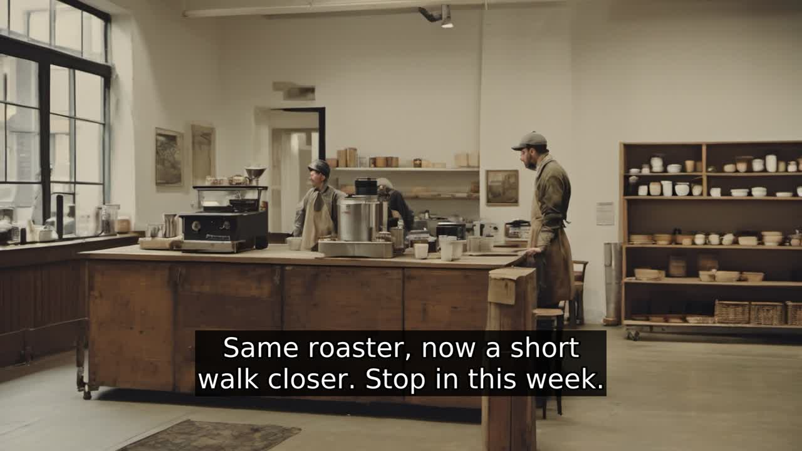
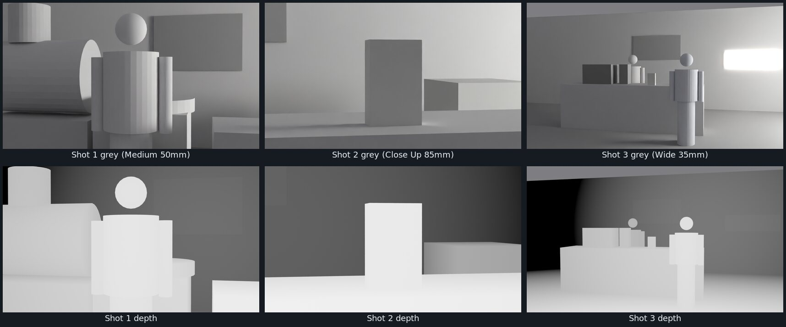
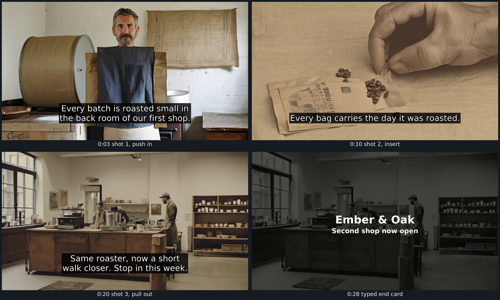

# Worked Example: Ember & Oak, Start to Finish

One complete run of the workshop build, done on one machine on 2026-10-22 with only local tools. Every file here is real output, including the mistakes. Use it to see what each stage produces before you run your own.

## About the gate decisions in this example

There was no human director in the room for this run. Gate decisions are recorded as "Workshop director (demo stand-in)", and the Revise notes and hand edits were made by Claude, the AI assistant that built and ran the kit, playing that role. **The release is not signed.** In your run, a person makes every gate decision.

## Machine used

NVIDIA RTX 2070 SUPER (8 GB), Ubuntu Linux, Ollama 0.18.2 with `llama3.2:3b`, Blender 5.2.2, ComfyUI 0.42.0 with SDXL base 1.0 and a small depth ControlNet, openai-whisper `base.en`, ffmpeg 6.1.1. Full timings are in [the hardware matrix](../../environment/hardware-matrix.md).

## What happened at each gate

### Gate 01: Brief

The director's answers: for **neighbors who already walk past the new shop on their way to work**; they should feel **that the roastery down the street is part of their morning, not a chain**; they should **stop in at the second shop this week**. The room's exclusions: no slow-motion latte-art pour, no stock hipster-barista tropes or forced smiles, no claims we cannot source.

- **What the agent did:** drafted a valid brief in 58 seconds.
- **What broke:** it credited Man with a Movie Camera to Chris Cunningham (it is Dziga Vertov's, 1929), and its key message ("community-driven approach") had no source.
- **How we caught it:** the director read the draft. The schema check passed, so no script could have caught this.
- **Where a human made it better:** decision Revise; key message rewritten from facts SRC-001 to SRC-003 as "Small batches roasted in our back room, every bag dated, and now a short walk closer"; references replaced; then Approve.
- **Files:** `brief.agent-draft.json` (untouched model output), `brief.json` and `brief.md` (approved), `brief_state.json` (gate history).

### Gate 02: Previs

- **What the agent did:** wrote three shots in 14 seconds, passing schema, bible match, sources and runtime on its first attempt.
- **What broke:** shot 3 dressed the roaster in "a reclaimed oak apron" (the oak is the counter; the bible locks a waxed canvas apron with a brass pin). Every shot was static. The dated bag, the client's most specific fact, never appeared.
- **How we caught it:** the director compared the shot list with the bible.
- **Where a human made it better:** decision Revise; shot 2 became an 85mm close-up of the roaster dating a bag; camera moves added; continuity fixed. `run_breakdown.py --check-only` re-checked the edit, then Approve.
- Blender then blocked the three approved shots in 23 seconds.
- **Files:** `shots.agent-draft.json`, `shots.json`, `shots_state.json`, `previs/` (grey renders, depth passes, `previs.blend`, `previs.json`).

### Gate 03: Produce

- **What the model did:** rendered three keyframes, each guided by its depth pass, in about 22 seconds each.
- **What broke (take 1):** shot 1 had no person (the grey-box figure became an apron on a wall); shot 2 had no hand; shot 3 had gibberish lettering on a sign and turned into an outdoor kiosk.
- **How we caught it:** the director looked at every frame before approving any.
- **Where a human made it better:** prompts rewritten to name the person; signage removed from prompts and "lettering, signage" added to the bible's negative prompt (real lettering goes on a typed end card instead); depth guidance loosened for shots 2 and 3; three seeds each; the director picked one take per shot.
- **Files:** `frames/` (approved keyframes and `frames.json`), `frames/rejected-take-1/`, `frames/takes/` (all alternates as small JPEGs with their own provenance file).

### Post-production

- **Voiceover:** a SCRATCH track from Piper, because there was no one to record. It is marked as a stand-in everywhere and must be replaced by a human take.
- **Captions:** Whisper wrote "our first **shot**" for "shop" and dropped an "a". A human corrected both; the raw output is kept as `captions.whisper-raw.srt`.
- **Timeline:** `timeline.otio` for Kdenlive, checked by reading it back with OpenTimelineIO.
- **Cut:** `cut.mp4` with open captions and `cut_softsubs.mp4` with a closed-caption track, both 30.0 seconds at 1920 by 1080, 24 fps.
- **Technical QC:** passed. Minus 15.1 LUFS integrated, minus 1.5 dBTP true peak.

### Gate 04: Present

`audit.md` has checks 2, 5 and 6 filled by `pre_audit.py`, plus stand-in auditor notes for 1, 3 and 4. **Stand-in verdict: Revise, 5 of 7.** Continuity fails (the roaster's face changes between shots, there is an unlisted background figure, and the scar is missing), and check 7 is unsigned. That is the audit working as intended: the pipeline made a watchable cut in minutes, and the rubric still says it is not ready.

## Files

| File or folder | Stage | What it is |
| --- | --- | --- |
| `research_log.csv` | Evidence | The four client facts, each with a source id. |
| `brief.agent-draft.json` | Gate 01 | The model's brief exactly as generated. |
| `brief.json`, `brief.md` | Gate 01 | The approved brief, after the human rewrite. |
| `brief_state.json` | Gate 01 | Gate record: draft, Revise, Approve. |
| `shots.agent-draft.json` | Gate 02 | The model's shot list exactly as generated. |
| `shots.json` | Gate 02 | The approved shot list. |
| `shots_state.json` | Gate 02 | Gate record: draft, Revise, re-check, Approve, then the frame-review Revise, re-check, Approve. |
| `previs/` | Gate 02 | Grey renders, depth passes, `previs.blend`, `previs.json` with camera positions. |
| `frames/` | Gate 03 | Approved keyframes, `frames.json`, `frames_state.json`, rejected and alternate takes. |
| `audio/vo_scratch.wav` | Post | SCRATCH voiceover (synthetic stand-in). |
| `audio/vo_scratch_script.txt` | Post | When each line starts. |
| `captions.whisper-raw.srt` | Post | Whisper output, mistakes included. |
| `captions.srt` | Post | Human-corrected captions. |
| `timeline.otio` | Post | OpenTimelineIO rough cut for Kdenlive. |
| `cut.mp4` | Post | 30-second cut, open captions. |
| `cut_softsubs.mp4` | Post | Same cut, closed-caption track. |
| `qc.json` | Gate 04 | Technical QC measurements. |
| `audit.md` | Gate 04 | The 7-point audit, unsigned. |
| `provenance.csv` | Every stage | Every asset, including 5 rejected takes. |
| `poster.jpg` | Docs | A still from the cut. |

## Run it yourself

[`../run_demo.sh`](../run_demo.sh) reruns every stage into a new folder and stops at each gate for **you** to decide. Your output will differ: local models are repeatable but not byte-for-byte identical, which is exactly why approved work is committed at each gate.
