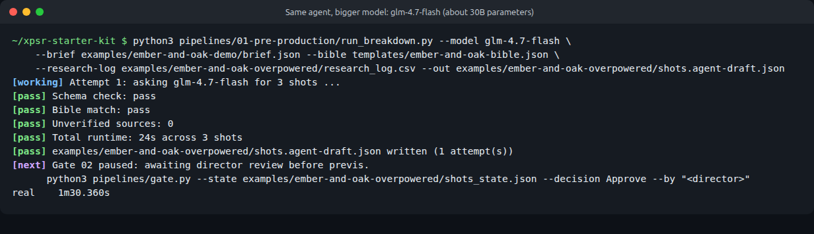

# Comparison: Workshop Models versus Bigger Models

The same Ember & Oak job, run again with larger local models, to see what extra compute buys and what it does not. Same machine (RTX 2070 SUPER, 8 GB VRAM), same day, still $0 and fully offline.

[Watch the full 30-second cut with sound (MP4)](cut.mp4). There is also [a version with a selectable caption track](cut_softsubs.mp4). The preview above loops without sound.

## What changed

| Stage | Workshop stack (`../ember-and-oak-demo/`) | Bigger stack (this folder) |
| --- | --- | --- |
| Writing model | `llama3.2:3b` (3 billion parameters, 2 GB) | `glm-4.7-flash` (about 30 billion parameters, mixture of experts, 19 GB, MIT license) |
| Image model | SDXL base 1.0 with a small depth ControlNet | FLUX.2 [klein] 4B (distilled, Apache 2.0) with the Qwen3 4B text encoder |
| How previs guides the image | Depth pass through ControlNet | Depth pass as a FLUX.2 reference image (`workflows/flux2_klein_previs_reference.json`) |
| Character prompts | Shot prompt only | Shot prompt plus each character's `visual_lock` from the bible (`--lock-characters`) |

To compare the image models fairly, both cuts use the **same human-approved brief, shot list, previs, seeds, voiceover and captions**. Only the keyframes differ. The text models were compared separately, on the same inputs, as drafts.

## Timings

| Step | Workshop stack | Bigger stack |
| --- | --- | --- |
| Brief draft | 58 s | 63 s |
| Shot breakdown, 3 shots | 14 s | 90 s (6 times slower) |
| One keyframe, 1344 by 768 | about 22 s (SDXL, 30 steps) | about 45 s (FLUX.2 klein, 4 steps, models partly in system RAM) |
| Renders needed to get 3 usable keyframes | 12 (3 rejected, 3 retakes, 6 alternates) | 3 (first take) |
| Image time to usable keyframes | about 4.5 minutes | about 2.5 minutes |

The bigger image model is twice as slow per frame and still finished sooner, because it did not need rerolls. That is the snake-versus-charmer point again: fewer pulls of the lever beats faster pulls.

## Text: what the bigger model got right, and wrong

Both models were given the identical client brief, research log, director answers and exclusions.

| | `llama3.2:3b` | `glm-4.7-flash` |
| --- | --- | --- |
| Key message | "Experience Ember & Oak's small-batch roasting and community-driven approach." Not backed by any source. | "Ember & Oak roasts small batches in the back room of its original shop and opens a second location a short walk away, with every bag labeled by roast date." Every clause cites the research log. |
| References | Credited Man with a Movie Camera to Chris Cunningham (it is Dziga Vertov's). | Before Sunrise (Linklater) and Days of Heaven (Malick) are real and apt. "The World of the Lonely Wolf" could not be found anywhere: probably invented. |
| Shot list | Put the roaster in "a reclaimed oak apron" (continuity error). Never showed the dated bag. | Found the dated-bag shot on its own, used bible details (the east-facing window, the hand-lettered sign), no continuity error. |
| Still needed a human | Yes | Yes: every shot static, 24 seconds instead of 30, and the call to action ("stop in this week") was dropped. |

Files: [`brief.agent-draft.json`](brief.agent-draft.json) and [`shots.agent-draft.json`](shots.agent-draft.json) are the untouched bigger-model drafts. Compare them with the same files in [`../ember-and-oak-demo/`](../ember-and-oak-demo/).

## Images: side by side

- **Continuity:** with `--lock-characters`, the roaster is recognizably the same man in all three shots, with the burn marks the bible asks for. The SDXL roaster changed face between shots.
- **Previs:** feeding the grey render as the reference made FLUX.2 copy the grey figures as statues and mannequins. Feeding the depth pass with "this is a depth map" fixed it. Both attempts are described in [the production README](../../pipelines/02-production/README.md#flux2-klein-a-stronger-image-model).
- **Still wrong:** pseudo-text on the shot 1 chalkboard, and an extra customer in shot 3. FLUX.2 klein has no negative prompt, so the bible's negative prompt is not applied.

## The audit

[`audit.md`](audit.md): **stand-in verdict Revise, 6 of 7**, against 5 of 7 for the SDXL cut. Continuity moves from fail to pass with a note. The cut is still not releasable because the voiceover is a synthetic stand-in and no human has signed.

## Bottom line for the workshop

Bigger models made fewer mistakes, and fewer rerolls, but **not zero mistakes**. Every gate still caught something: an invented reference, a dropped call to action, pseudo-text, an extra person. The workshop runs on the small stack on purpose: it fits on an ordinary laptop, and the human gates matter just as much either way.

## Files

| File or folder | What it is |
| --- | --- |
| `research_log.csv` | Same four client facts as the demo. |
| `brief.agent-draft.json` | `glm-4.7-flash` brief draft (comparison only). |
| `shots.agent-draft.json`, `shots_state.json` | `glm-4.7-flash` shot draft and its unreviewed gate record (comparison only). |
| `brief.json`, `shots.json` | Copies of the human-approved files from the demo, used for this cut. |
| `frames/` | FLUX.2 klein keyframes, `frames.json`, `frames_state.json`. Depth passes come from `../ember-and-oak-demo/previs/`. |
| `audio/`, `captions.srt` | Same scratch voiceover and corrected captions as the demo. |
| `timeline.otio`, `cut.mp4`, `cut_softsubs.mp4`, `cut-preview.webp` | Timeline, the two cuts, and the silent preview. |
| `qc.json`, `audit.md`, `provenance.csv` | QC, the audit with stand-in notes, and the ledger. |
