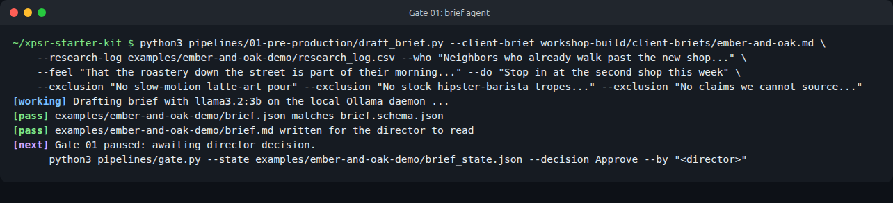
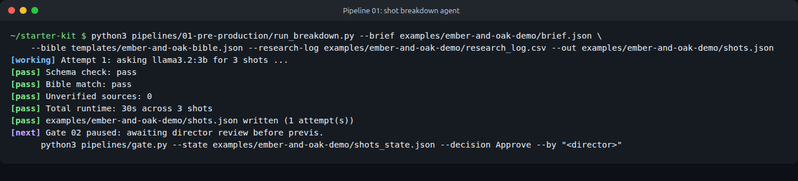

# Pipeline 01: Pre-Production

From a client brief to an approved shot list. Runs on any laptop with Ollama and `llama3.2:3b`. No GPU needed.

## Inputs and outputs

| Step | Reads | Writes | Gate |
| --- | --- | --- | --- |
| `draft_brief.py` | Client brief, `research_log.csv`, the director's three answers, three or more exclusions | `brief.json`, `brief.md`, `brief_state.json` | Gate 01 Brief |
| `run_breakdown.py` | Approved `brief.json`, `bible.json`, `research_log.csv` | `shots.json`, `shots_state.json`, a row in `provenance.csv` | Gate 02 Previs |

## Step 1: draft the brief

The director answers: who is it for, what should they feel, what should they do next? The room adds three exclusions. Then:

```bash
python3 pipelines/01-pre-production/draft_brief.py \
    --client-brief workshop-build/client-briefs/ember-and-oak.md \
    --research-log my-project/research_log.csv \
    --who "Neighbors who already walk past the new shop on their way to work" \
    --feel "That the roastery down the street is part of their morning, not a chain" \
    --do "Stop in at the second shop this week" \
    --exclusion "No slow-motion latte-art pour" \
    --exclusion "No stock hipster-barista tropes or forced smiles" \
    --exclusion "No claims we cannot source, such as best coffee in town" \
    --director "Sam" --out-dir my-project
```

The director's answers and the exclusions are copied into the brief word for word: the model cannot rewrite them. It drafts only a working title, a key message (from the research log's facts), tone words and references.



**Read the draft.** In the demo, the model credited Man with a Movie Camera to Chris Cunningham (it is Dziga Vertov's, 1929) and wrote an unsourced key message. The director chose Revise, fixed both by hand, and then approved.

```bash
python3 pipelines/gate.py --state my-project/brief_state.json --decision Approve --by "Sam"
git add -A && git commit -m "Gate 01: brief approved"
```

## Step 2: break it into shots

```bash
python3 pipelines/01-pre-production/run_breakdown.py \
    --brief my-project/brief.json \
    --bible templates/ember-and-oak-bible.json \
    --research-log my-project/research_log.csv \
    --out my-project/shots.json
```

The agent asks the model for three shots (change with `--shots`), then runs four checks with no model involved:

1. **Schema:** `shots.json` matches `schemas/shot_breakdown.schema.json`.
2. **Bible match:** every `location_id` and character id exists in the bible.
3. **Sources:** every `source_id` exists in the research log, and every spoken line cites one.
4. **Runtime:** shot lengths add up to between 80 and 100 percent of the brief's runtime.

If any check fails, the exact errors go back to the model and it tries again (up to `--retries`, default 3). Then it stops at Gate 02.



## Step 3: the director edits, the checker re-checks

A director may change anything in `shots.json` by hand. Then run the same checks without calling the model:

```bash
python3 pipelines/01-pre-production/run_breakdown.py --brief my-project/brief.json \
    --bible templates/ember-and-oak-bible.json --research-log my-project/research_log.csv \
    --out my-project/shots.json --check-only
```

`--check-only` keeps the gate history and adds a `human_edit_rechecked` entry.

## Use a different model

Any model you have pulled in Ollama works:

```bash
ollama pull qwen2.5:7b
python3 pipelines/01-pre-production/run_breakdown.py ... --model qwen2.5:7b
```

Larger models write more specific, better-sourced drafts but run several times slower: see [the comparison](../../examples/ember-and-oak-overpowered/README.md), where `glm-4.7-flash` took 90 seconds for a shot list that `llama3.2:3b` wrote in 14. Thinking models (such as `glm-4.7-flash` or `qwen3`) work too: the scripts switch thinking off for structured output, because otherwise Ollama returns the JSON in its `thinking` field and leaves the answer empty.

Set `TCC_MODEL` to change the default for every script, and `OLLAMA_HOST` if Ollama runs somewhere other than `127.0.0.1:11434`.

## Troubleshooting

| Problem | Fix |
| --- | --- |
| `Could not reach Ollama` | Open the Ollama app, or run `ollama serve` in another terminal. |
| `Ollama returned HTTP 404` | The model is not pulled: `ollama pull llama3.2:3b`. |
| Slow first call | The model is loading into memory. Later calls are faster. Close other apps on 8 GB machines. |
| Fails all three attempts | Read the errors it printed. Usually the bible's ids or the research log are missing something the brief asks for. Fix the inputs, not the output. |
