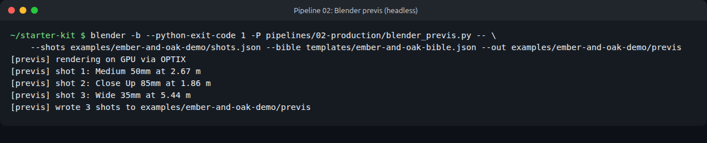
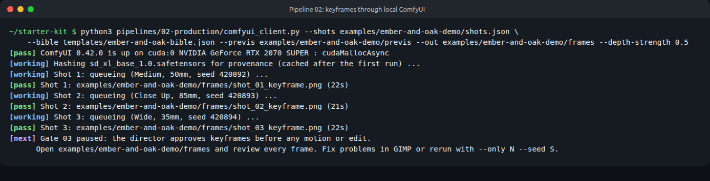

# Pipeline 02: Production

From an approved shot list to approved keyframes, in two passes: lock the layout in 3D, then let the image model paint inside it.

| Step | Needs | Reads | Writes |
| --- | --- | --- | --- |
| `blender_previs.py` | Blender 4.2 or newer (any laptop; uses the GPU if it finds one) | `shots.json`, `bible.json` | `previs/shot_NN_grey.png`, `previs/shot_NN_depth.png`, `previs.blend`, `previs.json` |
| `comfyui_client.py` | A running ComfyUI (GPU laptop) | `shots.json`, `bible.json`, the depth passes | `frames/shot_NN_keyframe.png`, `frames.json`, `frames_state.json`, provenance rows |
| `workflows/` | | | ComfyUI graphs in API format |

## Pass 1: grey-box previs in Blender

```bash
blender -b --python-exit-code 1 -P pipelines/02-production/blender_previs.py -- \
    --shots my-project/shots.json \
    --bible templates/ember-and-oak-bible.json \
    --out my-project/previs
```

`-b` runs Blender with no window. The script builds a grey-box set for each location in the bible, places one camera per shot with that shot's real focal length, and frames it by the shot's framing (a Wide fills about 3.2 metres of height at the subject, a Close Up about 45 centimetres). It renders a clay image for the director and a depth pass (near is white, far is black) for ControlNet.




**Gate:** the director approves the framing. Open `previs/previs.blend` in Blender to move a camera by hand, then rerender. The `roastery` and `new_shop` sets are hand-made for the demo; any other location id gets a generic room with a table and two figures.

## Pass 2: keyframes in ComfyUI

Start ComfyUI (`python main.py --listen 127.0.0.1 --port 8188`), then:

```bash
python3 pipelines/02-production/comfyui_client.py \
    --shots my-project/shots.json \
    --bible templates/ember-and-oak-bible.json \
    --previs my-project/previs \
    --out my-project/frames \
    --comfyui-dir ~/ComfyUI
```

For each shot it uploads the depth pass, builds the prompt from the shot's `visual_prompt` plus the bible's `style_prompt` and `negative_prompt`, uses a fixed seed (base seed plus shot number), queues the graph, waits, downloads the frame and logs a provenance row with the checkpoint's SHA-256 (hashed once, then cached).



### Useful options

| Option | Use it to |
| --- | --- |
| `--only 2 --only 3` | Rerender only some shots. |
| `--seed 8000` | Try another take. Shot N uses seed + N. |
| `--suffix _s8000` | Keep alternate takes side by side instead of overwriting. |
| `--depth-strength 0.45` | Loosen the depth guide (default 0.6 in the workflow). |
| `--depth-end 0.45` | Stop applying depth partway through, so the model can add detail such as people. |
| `--workflow pipelines/02-production/workflows/sdxl_txt2img.json` | Render with no depth pass at all. |

## What broke in the demo, and how we caught it


1. **Take 1 was rejected.** Shot 1 had no person: the grey-box figure became an apron on the wall. Shot 2 had no hand. Shot 3 put gibberish letters on a sign and became an outdoor kiosk.
2. **Human fix:** the Frames crew rewrote the prompts to name the person explicitly, dropped the signage (real lettering goes on a typed end card) and added "lettering, signage" to the bible's negative prompt.
3. **Take 2** fixed shot 1. Shots 2 and 3 got three seeds each with a looser depth guide, and the director picked one of each. All rejected and unpicked takes are kept as small JPEGs with their own provenance rows.

## Gate 03

```bash
python3 pipelines/gate.py --state my-project/frames/frames_state.json --decision Approve \
    --by "Sam" --provenance my-project/provenance.csv
```

`--provenance` stamps the director's name on every pending keyframe row.

## Paint-over and motion

- **Paint-over:** fix hands, faces or stray text in GIMP before approval. Log the edit as its own provenance row (`stage` = `paint_over`, `tool_or_model` = `GIMP`).
- **Motion (optional, GPU):** animate approved stills only, with an image-to-video model such as Wan 2.2 5B in ComfyUI. Never prompt text-to-video from scratch: locked stills mean less warping and face drift. The demo did not run motion; it used the animatic path in Pipeline 03.
