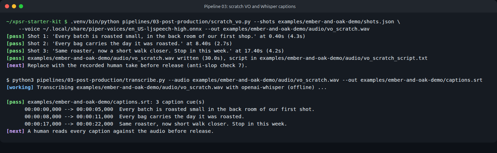
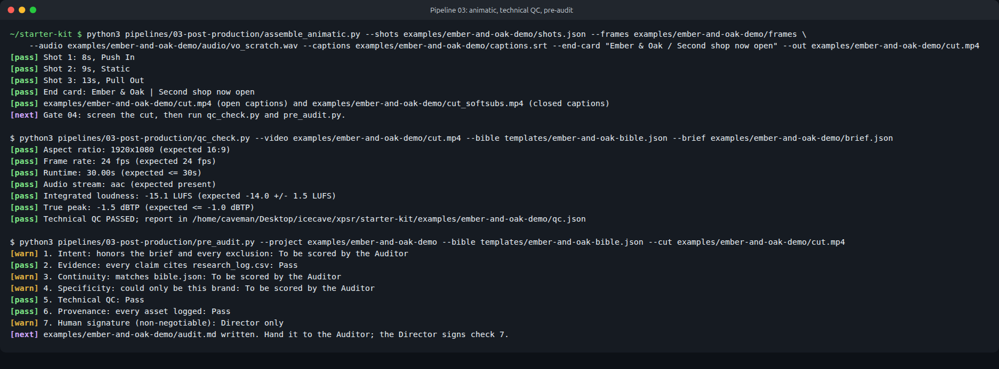

# Pipeline 03: Post-Production

From approved keyframes to a captioned, measured cut with a pre-filled audit. Everything here runs on an ordinary laptop.

| Step | Script | Writes |
| --- | --- | --- |
| Scratch voiceover (optional) | `scratch_vo.py` | `audio/vo_scratch.wav`, `audio/vo_scratch_script.txt` |
| Captions | `transcribe.py` | `captions.srt` |
| Timeline for Kdenlive | `generate_timeline.py` | `timeline.otio` |
| Animatic cut | `assemble_animatic.py` | `cut.mp4` (open captions), `cut_softsubs.mp4` (closed captions) |
| Technical QC | `qc_check.py` | `qc.json` |
| Pre-filled audit | `pre_audit.py` | `audit.md` |

## 1. Voiceover

In the workshop the Edit & Sound crew records the voiceover on a phone. Use that file.

To time the edit before the human take exists, `scratch_vo.py` reads each shot's `voiceover_line` with Piper (local text-to-speech) and places it 0.4 seconds after the shot starts. Its provenance row says SCRATCH, and the pre-audit flags it until it is replaced.

```bash
.venv/bin/python -m piper.download_voices --download-dir ~/.local/share/piper-voices en_US-ljspeech-high
.venv/bin/python pipelines/03-post-production/scratch_vo.py --shots my-project/shots.json \
    --voice ~/.local/share/piper-voices/en_US-ljspeech-high.onnx --out my-project/audio/vo_scratch.wav
```

## 2. Captions with Whisper

```bash
python3 pipelines/03-post-production/transcribe.py --audio my-project/audio/vo.wav \
    --out my-project/captions.srt --provenance my-project/provenance.csv
```

Uses openai-whisper (`base.en` by default) or whisper.cpp (`--engine whisper.cpp --model-path ggml-base.en.bin`). Audio never leaves the machine. With openai-whisper, captions are broken at 42 characters and 2 lines (`--max-line-width`, `--max-line-count`), using word timestamps, so no caption becomes a wall of text. A person should still re-cut any caption that runs across a shot change.



**A person reads every caption against the audio.** In the demo Whisper wrote "our first **shot**" for "shop" and dropped the "a" in "now a short walk". The raw output is kept as `captions.whisper-raw.srt`, and the correction is noted in `provenance.csv`.

## 3. Timeline for Kdenlive

```bash
python3 pipelines/03-post-production/generate_timeline.py --shots my-project/shots.json \
    --frames my-project/frames --audio my-project/audio/vo.wav \
    --captions my-project/captions.srt --fps 24 --out my-project/timeline.otio
```

Writes an OpenTimelineIO file: keyframes on video track V1 at the shot lengths, the voiceover on A1, and one marker per caption. Open it in Kdenlive with **File, Open** (Kdenlive 23.04 or newer) to recut, grade and mix by hand. Media paths are relative to the `.otio` file, so keep the project folder together.

## 4. Animatic cut with ffmpeg

The participant guide's "No GPU? Cut the keyframes together as an animatic" path, and the quickest way to screen something at Gate 04:

```bash
python3 pipelines/03-post-production/assemble_animatic.py --shots my-project/shots.json \
    --frames my-project/frames --audio my-project/audio/vo.wav --captions my-project/captions.srt \
    --fps 24 --end-card "Ember & Oak / Second shop now open" --out my-project/cut.mp4
```

Each still becomes a clip with a gentle digital move from its `camera_move` (Push In, Pull Out, Pan, Tilt, Handheld; Static stays still). Audio is normalized to minus 14 LUFS with a true peak at or below minus 1.5 dBTP. Two files come out:

- `cut.mp4` has captions burned in: white text on a mostly opaque dark box, readable over any frame.
- `cut_softsubs.mp4` has a selectable English subtitle track for players that support closed captions.

The end card is typed by a person, so it is real, legible lettering instead of generated pseudo-text.


## 5. Technical QC and the pre-filled audit

```bash
python3 pipelines/03-post-production/qc_check.py --video my-project/cut.mp4 \
    --bible templates/ember-and-oak-bible.json --brief my-project/brief.json
python3 pipelines/03-post-production/pre_audit.py --project my-project \
    --bible templates/ember-and-oak-bible.json --cut my-project/cut.mp4
```

`qc_check.py` measures aspect ratio, frame rate, runtime, loudness and true peak against the bible and brief (anti-slop check 5). `pre_audit.py` fills in checks 2, 5 and 6 and leaves 1, 3, 4 and 7 marked for people. It never fills in check 7.


