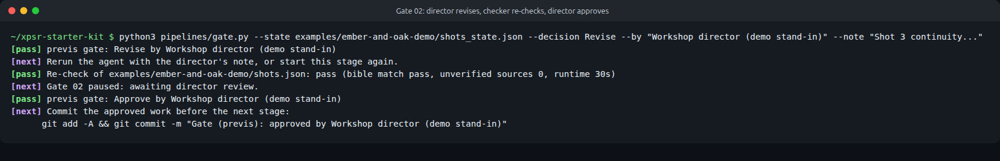

# Pipelines

The studio works in three stages. Each stage ends at a human gate, and approved work is committed to Git before the next stage starts.

## The flow, step by step

1. **Gate 01, Brief.** The director answers three questions. The Writer crew drafts `brief.md` with a local model. The room adds three exclusions. The director decides.
2. **Pre-production** (`01-pre-production/`). The shot-breakdown agent writes `shots.json`. A script checks it against the schema, the bible and the research log.
3. **Gate 02, Previs.** Blender blocks each shot in grey boxes with the real lens and renders a depth pass. The director approves the framing.
4. **Production** (`02-production/`). ComfyUI renders one keyframe per shot, guided by its depth pass. Optional: `comfyui_motion.py` animates approved stills with Wan 2.2 5B.
5. **Gate 03, Produce.** The director approves keyframes before any motion or edit. Rejected takes stay on record.
6. **Post-production** (`03-post-production/`). Voiceover, Whisper captions, an OpenTimelineIO timeline for Kdenlive, an animatic cut, technical QC and a pre-filled audit.
7. **Gate 04, Present.** Screen the cut, run the 7-point anti-slop audit, and the director signs.

## Folders

| Folder | Stage | Main scripts |
| --- | --- | --- |
| [`01-pre-production/`](01-pre-production/README.md) | Brief and shot list | `draft_brief.py`, `run_breakdown.py` |
| [`02-production/`](02-production/README.md) | Previs, keyframes and motion | `blender_previs.py`, `comfyui_client.py`, `comfyui_motion.py`, `workflows/` |
| [`03-post-production/`](03-post-production/README.md) | Sound, captions, cut, QC | `scratch_vo.py`, `transcribe.py`, `generate_timeline.py`, `assemble_animatic.py`, `qc_check.py`, `pre_audit.py` |

## Shared files

| File | What it does |
| --- | --- |
| `gate.py` | Records a human decision: Approve, Revise, Reject or Request Evidence. Updates the state file's history, can stamp the approver on pending `provenance.csv` rows, and refuses to approve a draft that failed its schema check. |
| `common.py` | Shared helpers: the local Ollama client, schema validation, the provenance ledger and state files. Standard library only. |

## Recording a gate decision

```bash
python3 pipelines/gate.py --state my-project/shots_state.json \
    --decision Revise --by "Sam (director)" --note "Shot 2 should be 50mm, not 85mm"
```



## Design rules every script follows

- **Local only.** The only network calls go to `127.0.0.1` (Ollama on port 11434, ComfyUI on port 8188). No API keys.
- **Standard library first.** Python 3.9 or newer and nothing else for the core path. Optional helpers live in `requirements.txt`.
- **Repeatable.** Fixed seeds and temperature 0. A local model rerun is close but not always byte-identical (we saw one phrase change between two runs with the same seed), which is why approved outputs are saved and committed instead of regenerated.
- **Logged.** Every generated asset gets a row in `provenance.csv`, including rejected takes.
- **Paused.** Every agent stops at a gate and prints the exact command for the human decision.
- **Readable output.** Status lines start with a word (`[pass]`, `[fail]`, `[warn]`, `[next]`) so they make sense without color or symbols.
